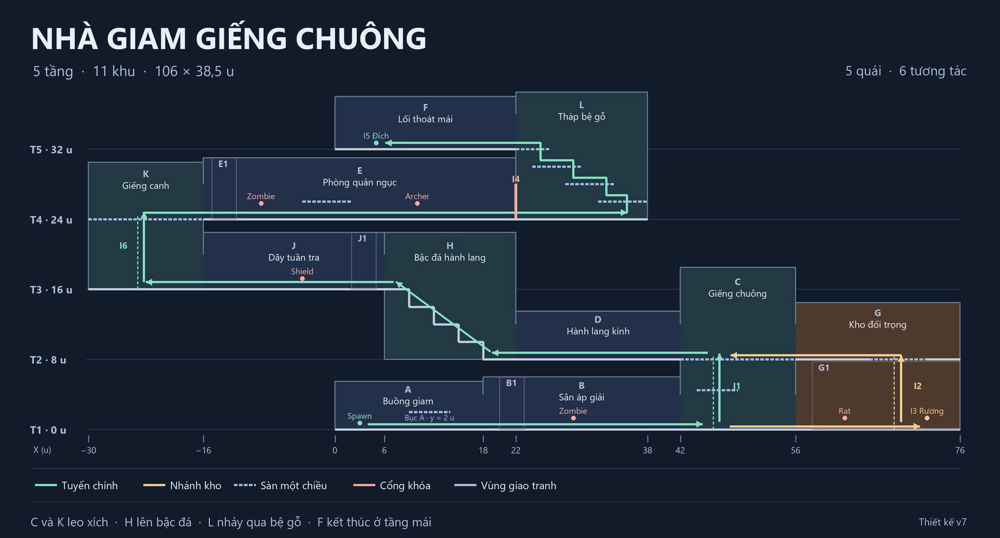

# Nhà Giam Giếng Chuông · Thiết kế màn v7

> **Trạng thái bản dựng thực tế (đối chiếu 26/11/2026):** Unity `6000.6.9f1`, target `[Windows, WebGL]`. `ProjectSettings/EditorBuildSettings.asset` đặt `Assets/_Project/Scenes/NhaGiamGiengChuong.unity` ở build index `0` và `Assets/_Project/Scenes/Main_Level.unity` ở build index `1`. Builder hiện tại (`NhaGiamGiengChuongBuilder` v8) tạo **10 room prefab** trong `Assets/_Project/Features/NhaGiamGiengChuong/Rooms/` (`AB`, `CD`, `ELF`, `G`, `HJK`, `W1_EastCourtyard`, `W2_SewerCistern`, `W3_WestBastion`, `U1_UpperPromenade`, `VaultA`) và scene `NhaGiamGiengChuong.unity` chứa **34 quái** (`Enemy_*`). Các mục bên dưới giữ nguyên đặc tả gốc v7 (5 tầng, 11 khu, 5 quái tuyến chính ban đầu).

Màn mở đầu SE220 đưa người chơi từ buồng giam ở tầng 1 lên cửa thoát ở tầng 5. Tuyến cố định uốn qua hai giếng đứng, một cầu thang đá và một tháp bệ gỗ. Người chơi tự chọn tốc độ ở nửa đầu màn, đánh đổi thời gian và rủi ro để lấy hồi máu ở kho, rồi giải quyết một trận phối hợp cận chiến và tầm xa để mở đường ra mái.

| Hạng mục | Phạm vi |
| --- | --- |
| 5 tầng chính | Mặt sàn tại **y = 0, 8, 16, 24 và 32 u**. Tuyến chính đi qua cả năm tầng. |
| 11 khu | **10 khu tuyến chính** A, B, C, D, H, J, K, E, L, F và **1 khu tùy chọn** G. C, G, H, K và L nối hai tầng kề nhau. |
| Khung không gian | **106 × 38,5 u**. X từ −30 đến 76. Y từ sàn thấp nhất 0 đến đáy trần cao nhất 38,5. |
| 5 quái | 2 Zombie, 1 Shield, 1 Archer, 1 Rat. Tuyến chính có 4 quái. Cổng cuối chỉ đếm 2 quái ở E. |
| 6 điểm tương tác | 3 xích và 1 rương dùng chủ động. Cổng và đích phản hồi tự động. Có thêm 4 vùng kích hoạt giao tranh. |

## Bài học từ Prisoners’ Quarters

Một lượt chơi PC của Jarygator cho thấy khoảng an toàn đầu màn, chuyển cao độ giữa các cụm địch, phần thưởng giúp hạ nhịp và lối ra đọc được từ xa. Giếng Chuông áp dụng bốn điểm này bằng buồng tập, hai kiểu lên tầng, nhánh kho hồi máu và đoạn đi yên sau trận cuối. Trật tự phòng, cao độ và vị trí địch là của Giếng Chuông. [Mở đầu](https://www.youtube.com/watch?v=nNc7raxAAvM&t=75s) · [Leo xích](https://www.youtube.com/watch?v=nNc7raxAAvM&t=90s) · [Phần thưởng](https://www.youtube.com/watch?v=nNc7raxAAvM&t=140s) · [Lối ra](https://www.youtube.com/watch?v=nNc7raxAAvM&t=340s)

## Sơ đồ và tuyến qua năm tầng

Sơ đồ dùng tỷ lệ khác nhau trên hai trục để dễ đọc. Các bảng ở mục **Tọa độ bản thô** quy định biên khu, bề mặt và lỗ mở.

| Tầng | Cao độ | Hành trình và nhịp |
| --- | ---: | --- |
| **T1 · Khu giam** | 0 u | Từ A chạy phải qua B tới chân giếng C. **Thong thả rồi tăng tốc** khi gặp Zombie đầu. Có thể né qua. Từ C, chọn leo thẳng hoặc rẽ phải qua kho G đấu Rat và lấy hồi máu. |
| **T2 · Hành lang kính** | 8 u | Từ miệng giếng C chạy **sang trái** qua D, rồi lên bốn bậc trong H. **Nhẹ và đều**, người chơi tập giữ nút nhảy để lên mặt cao hơn. Nhánh G nhập lại tại C ở tầng này. |
| **T3 · Dãy tuần tra** | 16 u | Từ đỉnh H đi **sang trái** vào J gặp Shield. **Chậm một nhịp để đọc mặt khiên**, sau đó lăn qua, đánh từ sau hoặc bỏ qua. Cuối J, xích K cho lên T4. |
| **T4 · Phòng quản ngục** | 24 u | Từ đỉnh K quay **sang phải** vào E. **Đỉnh áp lực** là Zombie gần cửa rồi thêm Archer khi tiến sâu. Hạ cả hai để mở cổng qua L. |
| **T5 · Lối thoát mái** | 32 u | Leo bốn bục một chiều trong L rồi đi **sang trái** vào F. **Hạ nhịp** sau trận cuối, đi bộ tới vòm sáng và kết thúc. |

Tuyến chính **A → B → C → D → H → J → K → E → L → F**. Nhánh kho **C ở T1 → G ở T1 → G ở T2 → C ở T2**. Người chơi cũng có thể rút khỏi kho bằng cửa dưới. Từ C ở T2, đoạn sàn bên phải dẫn người chơi trở lại kho nếu muốn hồi máu sau khi đã đi xa hơn. Đường quay lại vẫn đi qua các khu và các đoạn xuống tầng đã có.

## Trải nghiệm và thiết kế từng khu

Nhịp chủ đạo là **di chuyển nhanh giữa các điểm buộc người chơi quan sát**. A cho thử thao tác. B và J cho phép chọn đánh hoặc né nên lượt sau có thể chạy nhanh hơn. C và K đổi nhịp bằng leo xích, D cho chạy lấy đà, H và L cho liên tiếp các cú nhảy ngắn. E là nơi duy nhất buộc giải quyết giao tranh để đi tiếp. F cho một đoạn chạy yên kết thúc lượt.

| Khu | Bố trí và tín hiệu dẫn đường | Hành động và hệ quả |
| --- | --- | --- |
| **A · Buồng giam** | Spawn ở x = 3, quay phải. Đoạn sàn bằng dẫn qua bục tập x = 9–14, mặt bục y = 2 u. Đèn ở x = 13 kéo mắt về vòm sang B. | Thử chạy, lăn, nhảy lên bục hoặc thả xuống. Player đứng thẳng đi dưới bục tới B. Khoảng an toàn cho người chơi tự quyết định khi nào bắt đầu gặp địch. |
| **B · Sân áp giải** | Lối vào x = 18, vùng kích hoạt từ x = 20, Zombie xuất phát x = 29 và lối sang C ở x = 42. Giữ sàn bằng và vùng giữa hai cửa thoáng. | Bài học đấu đơn trên mặt phẳng. Đọc động tác chuẩn bị của Zombie rồi phản công, hoặc lăn qua và chạy tiếp. Zombie có thể tiếp tục truy đuổi theo hành vi sẵn có. |
| **C · Giếng chuông** | Dưới giếng, đèn cạnh xích x = 46 hướng lên bệ nghỉ và chuông. Đèn thấp gần x = 54 cùng vòm bên phải báo lối kho. Trên sàn y = 8, cửa D ở mép trái, cửa G ở mép phải. | Chọn leo ngay để tiến nhanh hoặc vào kho để tìm hồi máu. Leo tới bệ nghỉ rồi lên sàn trên. Sau khi lên, tuyến chính rẽ trái sang D. |
| **G · Kho đối trọng** | Rat ở x = 62 giữa cửa dưới và rương x = 72. Xích ở x = 68 nối sàn dưới với đường hồi về C ở y = 8. Mốc tời và đồ kho đặt ở nền sau, rương nổi bật ở cuối sàn dưới. | Đấu Rat để rảnh tay mở rương hoặc lách qua và chấp nhận bị đuổi. Người thiếu máu đổi thời gian và rủi ro lấy một lần hồi đầy. Người đầy máu có thể bỏ kho hoặc quay lại sau. Ra kho bằng xích, hoặc lùi về C theo cửa dưới. |
| **D · Hành lang kính** | Sàn phẳng từ x = 42 về x = 22. Ba cửa sổ làm mốc chạy về trái. Vòm x = 22 mở thẳng tới chiếu nghỉ trước bậc đá. | Khoảng nghỉ tốc độ sau giếng. Có thể chạy liền từ C rồi chủ động dừng trên chiếu nghỉ H để chuẩn bị nhảy. |
| **H · Bậc đá hành lang** | Bốn nhịp cao 2 u đi lên về trái. Mỗi mặt đáp có tối thiểu 3 u. Mép đá đặc có đường viền rõ và mặt sàn trùng với mép nhìn thấy. | Giữ nút nhảy, đáp rồi nhảy tiếp. Hụt bậc thì rơi về bậc hoặc chiếu nghỉ thấp hơn để thử lại. Đỉnh bậc mở sang J. |
| **J · Dãy tuần tra** | Player vào từ phải, Shield khởi đầu x = −4, còn đường chạy tới K ở x = −16. Giữ sàn giữa phòng thoáng để đọc hướng khiên và đổi bên. | Học đổi vị trí thay vì đánh liên tục vào mặt khiên. Lăn qua rồi đánh từ sau, hoặc giữ đà chạy qua K. K không khóa theo trạng thái Shield. |
| **K · Giếng canh** | Xích ở x = −24. Đèn giữa xích kéo mắt lên, đèn cửa trên tại (−17, 26) báo lối rẽ phải sau khi đáp ở y = 24. | Leo trong đoạn không có spawn mới. Chuyển từ chạy trái sang chạy phải, có chỗ đứng ở đầu xích trước khi bước vào E. |
| **E · Phòng quản ngục** | Cửa vào ở x = −16. Zombie đứng gần đầu phòng, bục một chiều ở giữa, Archer ở sâu bên phải, cổng I4 tại x = 22. | Tách Zombie ra xử lý ở nửa trái hoặc vượt qua để áp sát Archer trước. Bục giữa cho đổi cao độ trong lúc né riêng trục bắn và đòn cận chiến. Có thể lùi về K để thoát áp lực. Cổng mở sau khi cả hai bị hạ. |
| **L · Tháp bệ gỗ** | Qua cổng tại x = 22, chạy phải tới dưới bệ thấp ở x = 32–38. Bốn bệ đan từ phải lên trái. Trên cùng, bệ y = 32 ngang sàn cửa F. | Nhảy xuyên từ dưới và đáp vào phần chồng ngang để lên bệ kế. Hụt thì rơi về bệ dưới hoặc sàn y = 24. Có thể thử tiếp tại chỗ, với cổng vẫn mở. |
| **F · Lối thoát mái** | Từ cửa phải x = 22, đi trên đoạn sàn phẳng về vòm sáng tại x = 5. Đặt vùng đích lọt trong vòm. | Hạ nhịp sau E và L. Player bước vào vòm để hoàn thành lượt và thấy nút Chơi lại. |

### Nhịp độ mục tiêu

| Khu tuyến chính | A | B | C | D | H | J | K | E | L | F |
| --- | ---: | ---: | ---: | ---: | ---: | ---: | ---: | ---: | ---: | ---: |
| Mục tiêu lượt đầu, giây | 10–20 | 15–28 | 8–15 | 4–8 | 10–18 | 15–30 | 7–14 | 25–45 | 10–20 | 4–7 |

Mục tiêu lượt đầu **108–205 giây** tính từ lúc nhận điều khiển sau intro đến khi chạm đích. Qua kho dự kiến thêm **15–35 giây**, thành **123–240 giây**. E có thời lượng dài nhất vì phải xử lý hai địch. Người thuộc đường có thể bỏ Zombie B, Shield J và kho G để rút ngắn lượt. Các khoảng thời gian là mục tiêu cân chỉnh của thiết kế.

## Tọa độ bản thô

Đơn vị Unity unit (u). Gốc (0; 0) ở góc sàn A, X sang phải, Y lên. Tọa độ spawn là vị trí chân. Đặt mặt trên collider theo cao độ sàn, mặt dưới collider theo cao độ trần. Dùng bước 0,5 u cho phần lớn hình học. Tường và trần ngoài dày 0,5 u, nền dưới cùng dày 1 u, nên kích thước bao collider khoảng **107 × 40 u** trong x = −30,5 đến 76,5, y = −1 đến 39.

| Khu | X từ | X đến | Tầng / mặt sàn Y | Đáy trần Y | Rộng × cao bao |
| --- | ---: | ---: | --- | ---: | ---: |
| A · Buồng giam | 0 | 18 | T1 · 0 | 5,5 | 18 × 5,5 u |
| B · Sân áp giải | 18 | 42 | T1 · 0 | 6 | 24 × 6 u |
| C · Giếng chuông | 42 | 56 | T1/T2 · 0, 8 | 18,5 | 14 × 18,5 u |
| D · Hành lang kính | 22 | 42 | T2 · 8 | 13,5 | 20 × 5,5 u |
| H · Bậc đá hành lang | 6 | 22 | T2/T3 · 8, 16 | 22,5 | 16 × 14,5 u |
| J · Dãy tuần tra | −16 | 6 | T3 · 16 | 22,5 | 22 × 6,5 u |
| K · Giếng canh | −30 | −16 | T3/T4 · 16, 24 | 30,5 | 14 × 14,5 u |
| E · Phòng quản ngục | −16 | 22 | T4 · 24 | 31 | 38 × 7 u |
| L · Tháp bệ gỗ | 22 | 38 | T4/T5 · 24, 32 | 38,5 | 16 × 14,5 u |
| F · Lối thoát mái | 0 | 22 | T5 · 32 | 38 | 22 × 6 u |
| G · Kho đối trọng | 56 | 76 | T1/T2 · 0, 8 | 14,5 | 20 × 14,5 u |

Phạm vi sàn của từng tầng trong bảng dưới đây gồm các chiếu nghỉ giáp khu nối tầng. Tầng 2 và 3 có mặt sàn kết thúc ở chân hoặc đỉnh cầu thang, các bậc xen giữa thuộc H.

| Tầng | Mặt sàn Y | Khoảng X ở cao độ chính | Rộng sàn |
| --- | ---: | --- | ---: |
| T1 | 0 | 0 đến 76 | 76 u |
| T2 | 8 | 18 đến 76 | 58 u |
| T3 | 16 | −30 đến 9 | 39 u |
| T4 | 24 | −30 đến 38 | 68 u |
| T5 | 32 | 0 đến 26 | 26 u |

### Mặt va chạm và các bậc

Các đoạn đặc thông thường dày 1 u. Đoạn một chiều dày 0,25 u, sao cho collider cùng GameObject với effector. Dựng vỏ ngoài theo hợp các vùng phòng và lấp vách ở phần không thuộc lỗ mở. Các mặt sàn tiếp giáp tại cùng cao độ phải khớp mép. Bậc đặc H dùng một biên va chạm bậc thang liền từ x = 6 đến 22, đáy chung y = 7. Sàn gỗ L cho xuyên từ dưới, chừa khoảng trống để đi lại dưới bệ.

Trong khoảng x = 0 đến 22, mặt dưới sàn F ở y = 31 cũng là trần E. Dùng chung một collider cho phần sàn–trần này. Chỉ đặt trần riêng của E từ x = −16 đến 0.

| Bề mặt | X từ | X đến | Mặt trên Y | Kiểu |
| --- | ---: | ---: | ---: | --- |
| T1 A–B–C–G | 0 | 76 | 0 | Đặc |
| T2 D và chiếu nghỉ H | 18 | 42 | 8 | Đặc |
| T2 đỉnh C | 42 | 56 | 8 | Một chiều |
| T2 G tây | 56 | 65 | 8 | Đặc |
| T2 G trên xích phụ | 65 | 72 | 8 | Một chiều |
| T2 G đông | 72 | 76 | 8 | Đặc |
| H bậc 1 | 15 | 18 | 10 | Đặc |
| H bậc 2 | 12 | 15 | 12 | Đặc |
| H bậc 3 | 9 | 12 | 14 | Đặc |
| T3 K–J và đỉnh H | −30 | 9 | 16 | Đặc |
| T4 đỉnh K | −30 | −16 | 24 | Một chiều |
| T4 E–L | −16 | 38 | 24 | Đặc |
| L bệ 1 | 32 | 38 | 26 | Một chiều |
| L bệ 2 | 28 | 34 | 28 | Một chiều |
| L bệ 3 | 24 | 30 | 30 | Một chiều |
| L bệ 4 giáp F | 22 | 26 | 32 | Một chiều |
| T5 sàn F | 0 | 22 | 32 | Đặc |
| Bục tập A | 9 | 14 | 2 | Một chiều |
| Bệ nghỉ C | 44 | 49 | 4,5 | Một chiều |
| Bục chiến đấu E | −4 | 2 | 26 | Một chiều |

Mặt sàn tại x = 6 đến 9, y = 16 và x = 18 đến 22, y = 8 thuộc khối bậc đặc H. Đặt collider đặc riêng của K–J từ x = −30 đến 6 và của D từ x = 22 đến 42 để tránh chồng lên H. H mỗi bậc cao **2 u**, mặt chờ rộng ít nhất **3 u**. Ba dải chồng ngang giữa các bệ L lần lượt là **x = 32–34, 28–30 và 24–26**. Mỗi dải cho người chơi đứng dưới bệ kế rồi nhảy xuyên thẳng lên. Giữ thông khoảng trên và dưới các dải đó. Tuyến chính dùng nhảy giữ nút và leo xích. Nhảy kép là lựa chọn để đi nhanh hoặc sửa cú nhảy.

Bục A có mặt dưới tại **y = 1,75 u**, cho khoảng thông thủy 1,75 u trên sàn y = 0 với collider đứng cao 1,6 u. Căn mặt ván theo mặt trên collider và đặt chân đỡ ở lớp hình phía sau Player. [Collider Player](../Assets/_Project/Features/Player/Prefabs/Player.prefab#L5047)

| Lỗ mở | Tim X | Khoảng trống Y | Điều kiện |
| --- | ---: | --- | --- |
| A ↔ B | 18 | 0 đến 4 | Mở |
| B ↔ C | 42 | 0 đến 4 | Mở |
| C ↔ G dưới | 56 | 0 đến 4 | Mở |
| C ↔ G trên | 56 | 8 đến 12 | Mở |
| C ↔ D | 42 | 8 đến 12 | Mở |
| D ↔ H | 22 | 8 đến 12 | Mở |
| H ↔ J | 6 | 16 đến 20 | Mở |
| J ↔ K | −16 | 16 đến 20 | Mở |
| K ↔ E | −16 | 24 đến 28 | Mở |
| E ↔ L | 22 | 24 đến 28 | Cổng I4 chặn đến khi đủ hai địch E đã chết |
| L ↔ F | 22 | 32 đến 36 | Mở |

Vách ngăn dày 0,5 u. Tại các tim ghép có nhiều lỗ mở, tách theo phạm vi Y của hai phòng tiếp giáp. Tại x = 22 có cửa T2 tại D–H, cổng T4 tại E–L và cửa T5 tại L–F. Không kéo collider của từng cửa xuyên lên tầng khác.

## Giao tranh và độ khó

Đặt quái sẵn tại spawn để người chơi có thể thấy khi tới gần. Trước khi Player sống đi vào vùng, quái đứng tại chỗ, không tuần tra, không gây và không nhận sát thương. Mỗi vùng mở đúng một lần mỗi lượt, xét vị trí chân Player. Sau khi mở vùng, quái tiếp tục hoạt động khi người chơi lùi. Địch đã chết giữ nguyên trạng thái đến lần chơi lại. Prefab mặc định vào Idle rồi tự chuyển Patrol, cần wiring cấp màn để giữ trạng thái chờ. [Enemy Idle](../Assets/_Project/Features/Enemies/Scripts/States/EnemyIdleState.cs#L19)

| Vùng | Phạm vi kích hoạt X × Y | Quái tại tọa độ chân | Vai trò |
| --- | --- | --- | --- |
| B1 · Sân áp giải | [20; 23] × [0; 6] | **Zombie (29; 0)** | Đấu đơn hoặc lăn qua. Từ mép kích hoạt, cách địch 9 u ở vị trí xuất phát. |
| G1 · Kho dưới | [58; 76] × [0; 7,75] | **Rat (62; 0)** | Trận ngắn trước rương. Đi trên sàn y = 8 không kích hoạt Rat. Đi từ trên xuống kho hoặc vào từ C dưới đều kích hoạt. |
| J1 · Dãy tuần tra | [2; 5] × [16; 22,5] | **Shield (−4; 16)** | Đi vào từ phải. Đọc hướng khiên, vòng ra sau hoặc lăn qua để tới xích K. Bỏ qua vẫn hoàn thành màn. |
| E1 · Phòng quản ngục | [−15; −12] × [24; 31] | **Zombie (−9; 24)**, **Archer (10; 24)** | Zombie cách mép vào 6 u, Archer cách 25 u. Không khóa cửa quay lại K. Chỉ hai instance này được tính cho cổng I4. |

Các prefab Player, Zombie, Rat, Shield, Archer và Projectile_Arrow đã có. Ưu tiên đặt instance cùng wiring sandbox. Tầm phát hiện ban đầu theo phương ngang khoảng **7,5 u** cho Zombie, **6 u** cho Rat và **10,5 u** cho Archer. Nếu Archer chưa di chuyển và cùng cao độ, nó bắt đầu có thể phát hiện khi Player tới x ≈ −0,5, cạnh bục E. Kiểm tra tầm nhìn hoặc tín hiệu trước phát đầu. Shield chặn đòn trực diện theo cấu hình hiện có. [Prefab Shield](../Assets/_Project/Features/Enemies/Prefabs/Enemy_Shield.prefab#L134) · [Cấu hình Shield](../Assets/_Project/Features/Enemies/Data/Enemy_Shield.asset#L21) · [Hành vi Shield](../Assets/_Project/Features/Enemies/Scripts/EnemyController.cs#L89) · [Tầm địch](../Assets/_Project/Features/Enemies/Scripts/Data/EnemyData.cs#L163) · [Đạn Archer](../Assets/_Project/Features/Enemies/Data/Enemy_Archer.asset#L58)

### Phòng quản ngục E

| Không gian | Vai trò trong trận |
| --- | --- |
| **Cửa vào và nửa trái, x = −16 đến −4** | Người chơi vào trên mặt phẳng và gặp Zombie trước theo khoảng cách spawn. Sàn để trống cho một nhịp lùi hoặc lăn qua. Cửa về K vẫn mở, trận giữ tiến độ nếu Player rút lui. |
| **Bục giữa, x = −4 đến 2, y = 26** | Giao điểm của hai mối đe dọa. Player chọn tiếp tục áp sát trên sàn hoặc đổi cao độ qua bục một chiều. Có thể nhìn và đi dưới bục. Bục là lựa chọn né, không tính là chỗ nấp chặn đạn. |
| **Nửa phải, x = 2 đến 22** | Đường tới Archer và vùng đổi hướng trước cổng. Bố trí nền thoáng ở trục bắn, giữ thân Archer và động tác giương cung đọc được. Cổng đóng là mốc cuối sàn, nhả lối sang L khi trận kết thúc. |

E1 kích hoạt hai địch cùng lúc. Áp lực tăng khi Player tiến sâu và lọt vào tầm của Archer. Mục tiêu là cho người chơi thấy Archer hoặc động tác giương cung trước phát đầu có thể trúng, với đủ chỗ lăn, cúi hoặc nhảy. Nếu hạ Archer trước, trận trở về một mục tiêu cận chiến. Nếu hạ Zombie trước, Player còn hành lang trống để áp sát Archer. Địch còn sống vẫn có hành vi bình thường, và số địch đã hạ giữ nguyên nếu Player lùi ra. [Hành vi phát bắn](../Assets/_Project/Features/Enemies/Scripts/States/Attacks/EnemyShootAttackState.cs#L16)

## Sáu tương tác và vòng chơi

| ID | Vị trí | Quy tắc |
| --- | --- | --- |
| I1 · Xích giếng chuông | C, x = 46, y = −0,5 đến 8,5 | Giữ Lên để bám, xuyên bệ nghỉ rồi đáp trên sàn y = 8. Sau khi đáp có thể rẽ trái về D. Quay xuống bằng Xuống + Nhảy trên sàn một chiều, lặp lại nếu đáp trên bệ nghỉ y = 4,5. |
| I2 · Xích kho | G, x = 68, y = −0,5 đến 8,5 | Giữ Lên để leo lên y = 8 và đi trái về C. Từ trên, dùng Xuống + Nhảy ở phần sàn một chiều x = 65–72 để trở lại kho. |
| I3 · Rương | G, chân rương (72; 0). Trigger tâm (72; 0,75), rộng 2,5 u, cao 1,5 u | Một lần mỗi lượt. Hiện lời nhắc tương tác khi Player sống, thiếu máu và ở trong vùng. Nhấn Interact để hồi đầy. Tương tác khi đầy máu báo **Đầy máu** và giữ phần thưởng. Khi hồi thành công, tắt điểm sáng và dấu tương tác. |
| I4 · Cổng | E–L, x = 22, y = 24 đến 28 | Cổng đóng có song sắt chắn kín lỗ mở. Mở tự động khi hai quái E đều chết, dù thứ tự nào. Khi lối đi thông, song sắt biến mất đồng thời với collider chặn. |
| I5 · Đích | F, tâm (5; 33), kích thước 2 × 2 u | Player sống bước vào vòm sau khi I4 mở để ghi nhận điều kiện thắng. Kết quả và nút **Chơi lại** hiện khi lượt được chốt theo quy tắc bên dưới. Vòm sáng dẫn đến đúng vùng kích hoạt. |
| I6 · Xích giếng canh | K, x = −24, y = 15,5 đến 24,5 | Giữ Lên để leo từ y = 16 lên y = 24, đáp xong quay phải vào E. Khi quay về từ E, dùng Xuống + Nhảy trên sàn một chiều ở K để xuống y = 16 rồi đi sang J. |

Ba xích dùng trigger `Climbable` rộng 0,5 u. Sàn ngay trên mỗi xích là một chiều để Player lên xuyên qua và đáp. Chừa chỗ đặt chân ở đầu xích trước khi rẽ vào cửa. [Mẫu trigger xích](../Assets/_Project/Scenes/Sandbox_Player.unity#L605)

### Trạng thái một lượt chơi

1. **Bắt đầu.** Player xuất hiện tại **(3; 0)** hướng phải, đầy máu. Intro Player hiện có chạy một lần mỗi lượt, kể cả lượt bắt đầu bằng **Chơi lại**. Lượt bắt đầu tính thời gian khi intro trao lại điều khiển. Bốn vùng giao tranh chờ kích hoạt, rương còn hồi máu và I4 đóng. A là vùng an toàn để người chơi tự chọn lúc tiến vào B.
2. **Đang chơi.** Quái đã được kích hoạt giữ trạng thái khi Player đi lùi hoặc đổi tầng. Rương kiểm tra lượt còn hoạt động và Player còn sống, thiếu máu, trong vùng tại thời điểm cấp hồi máu. Chỉ trừ lượt dùng khi hồi thành công. Sau khi cả hai quái E chết, I4 giữ mở tới cuối lượt, kể cả khi Player quay lại tầng dưới.
3. **Kết thúc.** Luồng cấp màn ghi nhận điều kiện thắng từ I5 và điều kiện thua khi HP về 0. Chốt kết quả sau khi xét sát thương của cùng khung hình. Nếu cả hai điều kiện phát sinh trong khung đó thì kết quả là **Thua** theo cả hai thứ tự sự kiện. Nếu chỉ đủ điều kiện I5 thì kết quả là **Thắng**. Mỗi lượt hiện một kết quả. Sau khi chốt, khóa điều khiển Player và sát thương, giữ trạng thái rương, cổng và đích. Màn kết quả chờ thao tác **Chơi lại**.
4. **Chơi lại.** Lượt mới chỉ bắt đầu khi người chơi chọn **Chơi lại**, kể cả khi đã qua hạn hồi sinh mặc định của Player. Đưa Player về điểm xuất phát với đầy máu, khôi phục trạng thái đầu của 5 quái, 4 vùng giao tranh, rương và cổng, rồi chạy intro như khi mở màn. Dọn đạn lượt trước trước khi trả điều khiển. Luồng cấp màn sở hữu thời điểm bắt đầu lượt mới. [Intro Player](../Assets/_Project/Features/Player/Scripts/PlayerController.cs#L76) · [Player chết và respawn](../Assets/_Project/Features/Player/Scripts/PlayerController.cs#L153)

## Art, chiều sâu không gian và tín hiệu chỉ đường

Dùng một bộ **GothicDungeon** cho cả 11 khu. Các mảnh đá và gỗ lặp theo vai trò, còn chuông, cửa sổ và cổng là mốc nhận diện. Tách hình với collider. Tile art có Collider None, nền đá dùng collider đặc và ván leo tầng dùng collider một chiều. PPU hiện có là 32 ở bốn sheet và 128 ở sheet terrain phóng 4×. Grid palette 1 u dùng để chọn mảnh. Canh mép sprite theo mặt collider của từng sàn trước khi lặp. [Bộ GothicDungeon](../SourceAssets/Tilesets/GothicDungeon/README.md) · [Manifest](../SourceAssets/Tilesets/GothicDungeon/import-manifest.json) · [Mẫu one-way](../Assets/_Project/Scenes/Sandbox_Player.unity#L1808)

| Lớp nhìn | Quy tắc bố trí |
| --- | --- |
| **Nền xa** | Mảng tường, ô kính và máy móc dùng tông tối, ít tương phản. T1 cho cảm giác bị giam, D để ánh cửa sổ kéo đường nhìn ngang, F để vòm sáng đánh dấu đường thoát. |
| **Kiến trúc gần** | Dùng cột, vòm và viền sàn để cho thấy độ dày của tường và các lỗ mở. Mép sàn đá liền và rõ. Bệ một chiều dùng ván mỏng thấy được mặt dưới để báo có thể nhảy xuyên. Hành lang thiếu chỗ đặt prop ưu tiên giữ khoảng trống. |
| **Mặt chơi** | Player, địch, đạn, dây xích bám được, rương và cổng nổi rõ trên nền. Cột và cờ E nằm sau đường đạn. Quanh Archer, đầu xích và mép đáp L giữ nền đơn giản để đọc động tác, lối đi và điểm tiếp đất. |

Tín hiệu dùng cả hình dáng, vị trí và độ sáng. Ở C, xích thẳng đứng và đèn cao dẫn lên tuyến chính, còn vòm cạnh đèn thấp dẫn sang G. Ở K, đèn nằm phía cửa trên bên phải. Ở L, mỗi bệ sáng ở mép đáp lần lượt từ phải lên trái. Trong F, vòm sáng và vùng chạm đích trùng vị trí.

| Khu | Sprite có sẵn | Bố trí |
| --- | --- | --- |
| A | `MasonryRow1_004`, `CageChainAndGallows_001`, `LightAndBanner_005`, `WoodPlatform_007` | Lồng và đá ở nền, đèn tại (13; 2,5) thấy ngay từ spawn với camera 16:9. Cửa A–B lộ khi tiến tới. |
| B | `WallTrim_001`, `Arch_002`, `Pillar_002` | Sàn đá đọc được rõ, cột và vòm phía sau địch. |
| C | `MachineryAndBell_001`, `CageChainAndGallows_008`, `MasonryRow1_008`, `WoodPlatform_007`, `WoodPlatform_001` | Chuông tại (49; 11). Gợi hướng lên bằng đèn thấp tại (46; 5) và hướng kho bằng đèn ấm tại (54; 2,5). |
| D | `GothicWindow_003`, `WallPanel_004`, `WallTrim_001` | Ba cửa sổ tại x = 27, 32, 37, đặt sau đường chạy. Cửa sổ cao khoảng 4,88 u, vừa trần thông thủy 5,5 u. |
| H | `MasonryRow1_004`, `WallTrim_001`, `WallTrim_012` | Đá phủ cầu thang bốn bậc, canh mép đứng để không tạo cảm giác hụt chân. |
| J | `Arch_002`, `LightAndBanner_013`, `WallTrim_001` | Dãy vòm và cờ thấp ở nền. Mặt sàn để trống cho người chơi vòng ra sau Shield. |
| K | `CageChainAndGallows_008`, `MasonryRow1_008`, `WoodPlatform_001` | Đánh sáng xích tại (−24; 20) và cửa trên tại (−17; 26), dùng lại art giếng. |
| E | `Pillar_002`, `LightAndBanner_009`, `WoodPlatform_008`, `IronGate_001` | Cột và cờ sau tuyến đạn. Cổng sắt tĩnh, cao khoảng 4,06 u cho lỗ mở 4 u. |
| L | `WoodPlatform_001`, `WoodPlatform_007`, `WoodPlatform_008`, `WallPanel_004` | Bốn bệ tĩnh, lặp mô-đun và canh đúng mặt ván. Tín hiệu sáng lần lượt nổi dọc các bệ. |
| F | `DoorFrame_004`, `LightAndBanner_016`, `WallTrim_001` | Vòm sáng phía trái tại x = 5. Sprite vòm cao khoảng 5,19 u, vừa trong phòng cao 6 u. |
| G | `MachineryAndBell_012`, `StorageAndVessel_003`, `StorageAndVessel_010`, `StorageAndVessel_014`, `CageChainAndGallows_008`, `WoodPlatform_001` | Tời, đồ kho và rương tĩnh sẵn có. Rương rộng 3,31 u đặt tại x = 72 không vướng vách x = 76. |

C và K dùng bốn mô-đun `WoodPlatform_001` cho mỗi đoạn 14 u, G dùng hai mô-đun cho 7 u, scale X khoảng 1,02. A và bệ nghỉ C cần 5 u, hai `WoodPlatform_007` vừa với scale X khoảng 0,92. Bục E rộng 6 u, hai `WoodPlatform_008` vừa với scale X khoảng 0,98. H dùng mặt đá đặt theo từng bậc, L dùng ván gỗ căn theo từng bệ. Xích dùng ba đoạn `CageChainAndGallows_008` rồi canh hoặc chồng mép. Trạng thái rương thể hiện bằng lời nhắc và điểm sáng. Trạng thái cổng thể hiện bằng song sắt có mặt hoặc biến mất. Cả hai dùng được art tĩnh. [Manifest](../SourceAssets/Tilesets/GothicDungeon/import-manifest.json)

Camera lấy orthographic size **7** làm mốc, với bounds x = −32 đến 78 và y = −4 đến 43. Khung 16:9 cao 14 u, rộng khoảng 24,9 u. Các khung hình quan trọng là chân xích C thấy hai hướng, đầu xích K thấy cửa về phải, giữa E thấy tín hiệu Archer và dưới tháp L thấy bệ đầu tiên. Đích F nhìn rõ khi Player tiến tới trên sàn mái. Orthographic size và thời lượng theo khu là thông số cân chỉnh khi dựng. [Camera bounds](../Assets/_Project/Features/CameraSystem/Scripts/CameraFollow2D.cs#L108)

## Bàn giao cho plan thực thi

Đầu ra là scene `Assets/_Project/Scenes/NhaGiamGiengChuong.unity`, mở và chơi độc lập từ Editor. Lấy bảng tọa độ làm mốc dựng bản thô, kiểm tra đường đi với Player hiện có rồi đặt art GothicDungeon theo mặt va chạm đã kiểm tra.

Dùng `Sandbox_Player` làm mẫu gán Player, các enemy prefab, camera, VFX, hit-stop và projectile spawner. Plan cần đưa vào phần tích hợp cấp màn cho địch chờ kích hoạt, nhận action `Interact` của rương, đếm hai instance E cho I4 và điều phối đích, kết quả, chơi lại. [Wiring Sandbox](../Assets/_Project/Scenes/Sandbox_Player.unity#L1517) · [Input Interact](../Assets/_Project/Settings/Input/InputSystem_Actions.inputactions#L484) · [Health](../Assets/_Project/Features/Combat/Scripts/Health.cs#L61)

## Nghiệm thu bản dựng

| Ca kiểm tra | Điều kiện đạt |
| --- | --- |
| **A, H và L** | Đi bộ dưới bục A với tư thế đứng. Qua đủ bốn nhịp H và bốn bệ L bằng nhảy giữ nút, mỗi nhịp lên dùng một lần nhảy. Hụt ở H hoặc L thì có mặt đáp thấp hơn để thử tiếp. |
| **Xích và nhánh G** | Leo I1 và I6 qua sàn một chiều, đáp và đi được vào D hoặc E. Quay xuống C và K bằng thao tác đã chỉ định. Vào G từ C dưới, ra bằng cửa dưới hoặc leo I2 về C trên. Ở lượt chưa kích hoạt G1, đi từ C trên sang G tại y = 8 giữ Rat ở trạng thái chờ. Xuống kho qua phần sàn một chiều kích hoạt G1 khi chân Player đi vào vùng. |
| **Vùng giao tranh** | Trước khi vào vùng, địch hiện ở spawn, đứng yên và miễn sát thương, Player an toàn trước địch đang chờ. Mỗi vùng kích hoạt đúng một lần với Player sống. Rời vùng rồi quay lại giữ trạng thái của các địch đã kích hoạt. |
| **Rương I3** | Tương tác khi đầy máu hiển thị **Đầy máu** và rương còn lượt. Player sống, thiếu máu, trong vùng được hồi đầy và dấu tương tác tắt. Khi mất máu lần nữa trong cùng lượt, rương vẫn ở trạng thái đã dùng. Tương tác trễ sau khi Player chết hoặc rời vùng giữ nguyên lượt dùng rương. |
| **Trận E và cổng I4** | Một lượt có thể tới đích khi bỏ qua Zombie B, Shield J và kho G. Cổng chặn lối E–L khi còn bất kỳ quái E nào sống. Hạ Zombie rồi Archer hoặc làm ngược thứ tự đều mở cổng. Rút về K giữ tiến độ trận. Song sắt và collider chặn biến mất cùng lúc, cổng giữ mở tới hết lượt. |
| **Đích, kết quả và chơi lại** | Chạm I5 khi sống và I4 đã mở cho kết quả **Thắng** một lần. HP về 0 cho kết quả **Thua**. Thử hai thứ tự sự kiện của I5 và HP về 0 trong cùng khung hình, cả hai đều chỉ hiện **Thua**. Sau khi chốt, điều khiển Player và sát thương bị khóa, màn kết quả giữ qua hạn hồi sinh mặc định. Thử **Chơi lại** sau cả thắng lẫn thua, kiểm tra spawn, máu, intro, 5 quái, 4 vùng, rương, cổng và trạng thái đạn đúng như đầu lượt. |
| **Camera và tín hiệu dẫn đường** | Kiểm tra ở 16:9. Từ spawn thấy đèn A. Từ chân giếng C thấy xích và lối kho. Đầu xích K thấy cửa sang phải. Thấy Archer hoặc động tác giương cung trước phát đầu có thể trúng. Từ sàn L đọc được bệ đầu, và trên sàn F vòm sáng dẫn đúng vào I5. |
