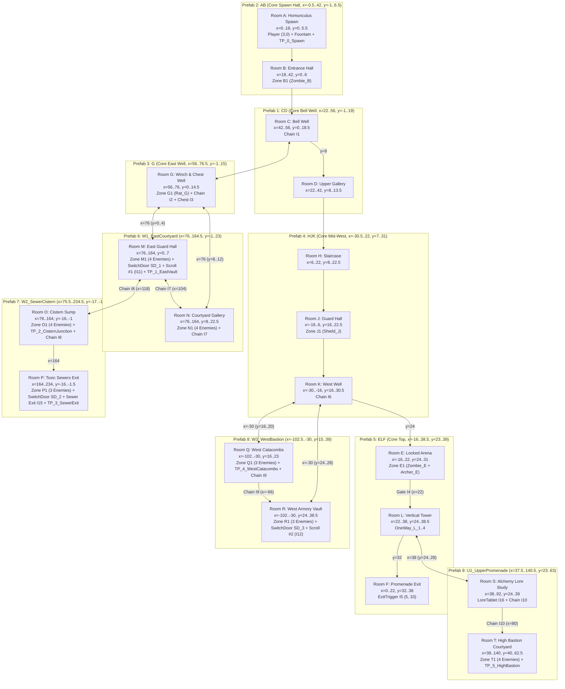

# Dead Cells *Prisoners' Quarters* Full-Scale Expansion (`NhaGiamGiengChuong` v8) — Design Specification

- **Date:** 2026-11-21
- **Target Scene:** `Assets/_Project/Scenes/NhaGiamGiengChuong.unity`
- **Target Feature Module:** `Assets/_Project/Features/NhaGiamGiengChuong/`
- **Baseline:** Round 5.1 (`64/64` passing tests, `4.63/5` independent Visual Scorecard on `NhaGiamGiengChuong.unity`, `4.68/5` on `Main_Level.unity`)
- **Unity Version:** `6000.6.9f1` (URP 2D `17.6.0`, Input System `1.19.0`, Test Framework `1.8.0`)

---

## 1. Intent and The Why

`NhaGiamGiengChuong.unity` (v7 / Round 5.1) achieved production-grade `24 PPU` visual fidelity (`4.63/5`, normal-mapped lighting, 4-tier hybrid parallax, zero-mixel custom props, and `35/35` passing EditMode + PlayMode tests), but its spatial footprint (`107u × 40u` physical envelope, `11` rooms in `5` prefabs, `~196u` walkable floor, `5` enemies, `4` encounter zones, `~60s` run duration) represents a **Vertical Slice (`~30%`)** of a real *Dead Cells — Prisoners' Quarters* (`PrisonStart`) biome. Furthermore, several signature *Prisoners' Quarters* systems already implemented in the repository (`PowerScrollPickup`, `PowerScrollInteraction`, `ScrollUpgradeMenu`, `ScrollPickupPresentation`, `GoldWallet`, `EnemyGoldDrops`, `GoldPickup`, `GoldHud`, `Enemy_Grenadier.prefab`, `Projectile_Grenade.prefab`, and `320+` unused `24 PPU` Prison sprites such as `prisonFountain_00`, `homonculusFlush_00`, `tpStoneUp/Down_00`, `switchCopper_00`, `alchemyBibli_00`, `tableauNoir_00`, `exitDoorPrisonCourtyard_00`, `exitDoorSewerShort_00`) are not yet integrated into `NhaGiamGiengChuong.unity`.

**The Goal:** Expand `NhaGiamGiengChuong.unity` into a full-scale **Dead Cells — *Prisoners' Quarters*** biome (**`337.0u × 80.0u`** physical collider envelope, **`19` rooms (`A`–`T`)** across **`9` modular Room Prefabs**, **`~756u` walkable surface**, **`30` enemies** across **`11` `EncounterZone`s** featuring all **5 enemy archetypes**, **`2` Scrolls of Power**, **live Gold Economy**, **`6` Teleportation Stones (`3` bi-directional pairs)**, **`3` Copper Switch Doors**, **`1` Alchemy Lore Study**, and **`2` Biome Exits**: *Promenade of the Condemned* and *Toxic Sewers*) while **preserving 100% of the existing v7 Core Spine room prefab tests (`A01`–`A05`), unit tests (`U01`–`U16`), and core-loop PlayMode tests (`P01`–`P06`)**.

---

## 2. Goals, Non-Goals, and Anti-Goals

### 2.1 Goals
1. **Full *Prisoners' Quarters* Spatial Scale (`337u × 80u`, `19` Rooms, `9` Modular Room Prefabs):**
   - Preserve the `5` existing Room Prefabs (`AB`, `CD`, `G`, `HJK`, `ELF` covering 11 rooms `A, B, C, D, G, H, J, K, E, L, F`) as the central **Core Spine** (`x ∈ [-30.5, 76.5], y ∈ [-1, 39]`).
   - Dock **`4` new modular Wing Prefabs** (`W1_EastCourtyard.prefab`, `W2_SewerCistern.prefab`, `W3_WestBastion.prefab`, `U1_UpperPromenade.prefab` covering 8 new rooms `M, N, O, P, Q, R, S, T`) onto the Core Spine via clean `4.0u` doorway openings at `x = 76` (`Room G`), `x = -30` (`Room K`), and `x = 38` (`Room L`).
   - Total physical envelope: **`x ∈ [-102.5, +234.5]` (`337.0u` width)**, **`y ∈ [-17.0, +63.0]` (`80.0u` height)**, Camera Bounds **`Rect(-104f, -20f, 340f, 86f)`**, total walkable surface **`~818u`** (`568u` solid floor + `228u` across `31` one-way platforms + `22u` `Stairs_H`), and **`7` climbable chains** (`I1, I2, I6, I7, I8, I9, I10`).
2. **Multi-Archetype Combat Density (`30` Enemies across `11` `EncounterZone`s):**
   - Retain the `5` core enemies (`Enemy_Zombie_B`, `Enemy_Rat_G`, `Enemy_Shield_J`, `Enemy_Zombie_E`, `Enemy_Archer_E`) and `4` core zones (`B1, G1, J1, E1`) at their exact v7 coordinates.
   - Add **`25` new dormant enemies** across **`7` new `EncounterZone`s** (`M1, N1, O1, P1, Q1, R1, T1`), bringing the total to **`30` enemies** (`8` `Enemy_Zombie`, `5` `Enemy_Rat`, `6` `Enemy_Archer`, `6` `Enemy_Shield`, and `5` `Enemy_Grenadier`).
   - Prewarm both `Projectile_Arrow.prefab` and `Projectile_Grenade.prefab` in `ProjectileSpawner._prewarm` (`arraySize = 2`).
3. **Unified Dead Cells Gameplay Systems in `NhaGiamGiengChuong.unity`:**
   - **2 Guaranteed Scrolls of Power (`I11_Scroll_EastCourtyard` at `(156, 0)` & `I12_Scroll_WestArmory` at `(-95, 24)`):** Clone `Scroll of Power - Entrance`, `Power Scroll HUD` (`ScrollUpgradeMenu` + `ScrollPickupPresentation`), and `Scroll cinematic` from `Assets/_Project/Scenes/Main_Level.unity` (opened read-only via `OpenSceneMode.Additive` during `BuildScene` before `BuildRound5SceneAtmosphereAndLighting` and closed without saving), parent `ScrollAura_R5_0..1` under `_icon` while preserving `_glow` pointing to `Scroll glow` (`Light2D`) per `[PM-2]`, attach a dedicated `AudioSource` (`playOnAwake = false`) to `Scroll cinematic` wired to `ScrollPickupPresentation._audio`, and wire `PowerScrollInteraction` on `Power Scrolls` into `PlayerController._powerScrolls`.
   - **Gold Drop & Wallet Loop (`Run Gold` + `Gold HUD`):** Create `Run Gold` GameObject carrying `GoldWallet` + `EnemyGoldDrops` (wired to `_wallet`, `_player = playerHealth`, `_pickupPrefab = Assets/_Project/Features/Currency/Prefabs/GoldPickup.prefab`, `_enemies` = all `30` enemies, `_goldPerEnemy = 20`), ensure `GoldPickup` (`GoldPickup.cs` & `GoldPickup.prefab`) defaults its `SpriteRenderer` sorting layer to `VFX` (`order = 5`, above `Background/Ground/Actors`) when set to `Default`, and clone `Gold HUD` (`GoldHud`) from `Main_Level.unity`'s `PlayerHUD` into `NhaGiamGiengChuong.unity`'s `PlayerHUD` wired to `GoldWallet`.
   - **Teleportation Coffin Network (`TeleportGate` — `6` Nodes / `3` Bi-Directional Pairs `TP_0..TP_5` with Proximity Discovery):** Implement deterministic `TeleportGate` where a stone becomes `IsDiscovered = true` (swapping `tpStoneUp_00` → `tpStoneDown_00`) when `_startsDiscovered` is true or when the living Player enters its `_triggerZone` during `IsPlaying`, and `[E]` teleportation is enabled only when **both `this.IsDiscovered && _pairedGate.IsDiscovered`** (preventing sequence-breaking warps into locked `SwitchDoor` vaults before the player physically reaches and discovers the destination stone!).
   - **Copper Switch Doors (`SwitchDoor` — `3` Lever-Operated Gates `SD_1..SD_3`):** Implement `SwitchDoor` (`switchCopper_off_00` → `switchCopper_00` on `[E]` press inside lever trigger, atomically disabling `_doorBarrierRoot` holding `hingeSmallDoor_00` + `BoxCollider2D` on layer `Ground`).
   - **Alchemy Lore Study (`LoreTablet` — `I16_LoreTablet` in Room S):** Safe lore study room featuring `alchemyBibli_00` and `tableauNoir_00` where pressing `[E]` toggles a world-space lore inspection banner (`VFX/26`) and walking out of `_triggerZone` or ending the run auto-closes it.
   - **Dual Biome Exits (*Promenade of the Condemned* & *Toxic Sewers*):**
     - Primary Tower Exit: `I5_ExitTrigger` (`ExitTrigger`) in `Room F` at `(5, 33)` (requires `I4_EncounterGate` open).
     - Secondary Sewer Exit: `I15_SewerExitTrigger` (`SecondaryBiomeExitTrigger`) in `Room P` at `(224, -15)` (requires `SD_2_SewerExit.IsOpen == true` AND both Room P elite guardians `Enemy_Shield_P1` and `Enemy_Archer_P1` dead, framed by `exitDoorSewerShort_00` + `Art_P_ExitGlow`). Both exits call `_run.RequestWin(frame)` and show the standard `ResultPanel` (`ResultPanel.WinTitle == "Thắng"`), keeping `LevelRunController.cs` and `ResultPanel.cs` 100% untouched.
4. **Full R4.2/R5.1 `24 PPU` Visual Pipeline Across All `19` Rooms:**
   - `1.0u` `VisualGrid` per Room Prefab (`9` `VisualGrid`s, `36` visual-only Tilemaps: `TM_Background`, `TM_WallDecals`, `TM_SolidVisual`, `TM_SolidRim` with `0` `TilemapCollider2D`).
   - Non-overlapping `PaintVisualDirtSkirt` bedrock fills under all lowest-tier and overhanging floors (see exact cell bounds in `§5.5 #6` below) so `0` tiles ever intrude into `Room O` or any playable room interior and `0` parallax pixels leak below any floor across the entire `340u × 86u` camera bounds.
   - `9` Carved Arch Viewing Bays (`#0..#8`, one per Room Prefab) framed on all 4 sides by `24 PPU` `ArchSill_*`, `ArchLintel_*`, `ArchJamb_L/R_*` (`Background/-17`), strictly clear of all landmarks and banners.
   - `88` `24 PPU` wall/ceiling sconce lanterns (`26` core @ `r = 7.6u` + `62` wing lower/mid/ceiling beacons @ `r = 9.5u..10.5u` + `Art_F_ExitGlow` & `Art_P_ExitGlow` @ `r = 7.2u`, with `LanternFixture_R5` `Background/-9`, `LanternFlameCore_R5` `Background/-8`, `TorchEmbers` `Background/-7`) ensuring `19/19` rooms meet `>= 95%` (`>= 50%` required) point-light coverage and `98.1%` (`>= 75%` required) total map coverage (`A10`), with `volumeIntensity = 0.09f` and `intensity <= 1.50f` (`A12`).
   - Expanded `Prison_Parallax_R5` (`5×4` `ParallaxFar` panels at `cols = {-64f, -32f, 0f, 32f, 64f}`, `rows = {-17.3333f, 4.0f, 25.3333f, 46.6667f}` + 4-tier `ParallaxMid` chunks at `tierYs = { -13.0f, 2.6f, 22.0f, 44.0f }` covering `y ∈ [-28, +57]` with `32u` horizontal wrapping) + `8` `GlowingMushroom` clusters + `6` `GroundMist_R5` strips + `6` `ShadowCasters_R5` + `8` multi-elevation `RoomBanner`s with `VertexSwayPin2D`.

### 2.2 Non-Goals
- Do **NOT** implement procedural random seed generation at runtime; `NhaGiamGiengChuongBuilder.BuildAll()` remains 100% deterministic in the Editor.
- Do **NOT** modify `Main_Level.unity`, `Sandbox_Player.unity`, `Player.prefab`, `PlayerHUD.prefab`, `LevelRunController.cs`, `ResultPanel.cs`, or any script under `Assets/_Project/Features/Player/` or `Assets/_Project/Features/Enemies/`.
- Do **NOT** replace `LegacyRuntime.ttf` or generate new art outside the existing 377 `24 PPU` sprites in `Assets/_Project/Art/Environment/Prison/Sprites/`.

### 2.3 Anti-Goals (Failure Conditions Even If Tests Pass)
- Breaking any of the `5` existing room prefab tests (`A01`–`A05`), `16` unit tests (`U01`–`U16`), or `6` core PlayMode tests (`P01`–`P06`).
- Introducing a second `HealingChest`, second `EncounterGate`, or second `ExitTrigger` instance that could make `Object.FindAnyObjectByType<HealingChest/EncounterGate/ExitTrigger>()` ambiguous in `A07` or `P03`–`P07`.
- Allowing `TP_0_Spawn` or `TP_2_CisternJunction` to warp into locked `SwitchDoor` vaults (`TP_1_EastVault`, `TP_3_SewerExit`) before the destination `TeleportGate` has been discovered.
- Painting any sub-floor dirt skirt tile inside `Room O` (`x ∈ [76, 164], y ∈ [-16, -1]`) or any other room's playable interior.
- Referencing any sprite filename that does not exist on disk in `Assets/_Project/Art/Environment/Prison/Sprites/` or any `32 PPU` legacy torch/lantern/table sprite (`LightAndBanner_001/005`, `WoodPlatform_007/008`).

---

## 3. Constraints (`AGENTS.md` §§0–2, §6, §9, §10)

1. **Assembly Boundaries (`.asmdef`):**
   - `NhaGiamGiengChuong.asmdef` continues to reference `["Core", "Combat", "Enemies", "Player", "CameraSystem", "VFX", "Unity.InputSystem", "UnityEngine.UI"]`.
   - To wire and test `GoldWallet`, `EnemyGoldDrops`, `GoldPickup`, `GoldHud`, `ScrollUpgradeMenu`, and `ScrollPickupPresentation`:
     - Add `"Currency"` to `NhaGiamGiengChuong.Editor.asmdef`, `NhaGiamGiengChuong.Tests.EditMode.asmdef`, and `NhaGiamGiengChuong.Tests.PlayMode.asmdef`.
     - Add `"HUD"` to `NhaGiamGiengChuong.Tests.PlayMode.asmdef` (`NhaGiamGiengChuong.Editor.asmdef` and `NhaGiamGiengChuong.Tests.EditMode.asmdef` already reference `"HUD"`).
     - Keep `Core`, `VFX`, `CameraSystem`, `Combat`, `Enemies`, `Player`, `Currency`, `HUD`, `RunFlow` `.asmdef` files untouched.
2. **Forbidden Modification Scope:**
   - Zero edits to `.fortress-workspaces/antigravity`, `Assets/_Project/Features/Player/**`, `Assets/_Project/Features/Enemies/**`, `Main_Level.unity`, `Sandbox_Player.unity`, or `.meta` files by hand.
   - `Assets/_Project/Features/Currency/Scripts/GoldPickup.cs` and `Assets/_Project/Features/Currency/Prefabs/GoldPickup.prefab` are **in-scope** for the 4-line sorting-layer guard (`Default` → `VFX` sorting layer, `sortingOrder = 5`) so dropped coins render above `TM_Background` (`Background/-20`).
3. **Single-Unity-Process Lock & Hygiene:**
   - Run all shell commands via `rtk` / `rtk proxy`.
   - Confirm `Get-Process Unity -ErrorAction SilentlyContinue` is empty before any Unity invocation; pass `$env:DOTNET_GCServer='0'` and `-job-worker-count 1`.
   - Restore `ProjectSettings/TimeManager.asset` and `ProjectSettings/ProjectSettings.asset` via `rtk git checkout --` after Unity batch runs.
   - Zero `CS0618`, `CS0414`, `warning CS`, `error CS`, `Shader error`, `Assertion failed`.

---

## 4. Architectural Approaches Considered

### Approach 1: Destructive Replacement of `AB, CD, G, HJK, ELF` Room Prefabs
- **Description:** Discard the v7 `11`-room coordinates and redesign all rooms from scratch in a new coordinate system.
- **Trade-offs:** Breaks `A01`–`A05` and `P01`–`P07`, invalidates 5 rounds of verified geometry and visual calibration. **Rejected.**

### Approach 2: Separate Standalone Scene (`PrisonersQuarters.unity`) Leaving `NhaGiamGiengChuong.unity` at Small Scale
- **Description:** Keep `NhaGiamGiengChuong.unity` at `107u × 40u` and create a third scene `PrisonersQuarters.unity`.
- **Trade-offs:** Duplicates scene maintenance across 3 scenes and leaves the user's active target map (`NhaGiamGiengChuong.unity`) at small slice scale instead of upgrading it as requested. **Rejected.**

### Approach 3 (Selected): Non-Destructive Modular Spine-and-Wings Expansion on `NhaGiamGiengChuong.unity`
- **Description:**
  - Preserve all `5` Core Spine room prefabs (`AB, CD, G, HJK, ELF`) and all `11` core rooms (`A..L`) at their exact v7 world coordinates (`x ∈ [-30.5, 76.5], y ∈ [-1, 39]`).
  - Carve `5` clean `4.0u` doorway openings in the outer boundary walls of `Room G` (`x = 76, y = 0..4` and `y = 8..12`), `Room K` (`x = -30, y = 16..20` and `y = 24..28`), and `Room L` (`x = 38, y = 24..28`) while keeping `(76.25f, 5.0f)` (`Wall_GM_Mid_76` `[76, 76.5] × [4, 7]`) and `(-0.25f, 2.5f)` (`Wall_A_West` `[-0.5, 0] × [-1, 5.5]`) solid so **`A01`–`A05` and `A08` pass 100% unmodified**.
  - Add **`4` new modular Wing Prefabs** (`W1_EastCourtyard.prefab`, `W2_SewerCistern.prefab`, `W3_WestBastion.prefab`, `U1_UpperPromenade.prefab`) containing **`8` new rooms (`M, N, O, P, Q, R, S, T`)**.
  - Keep `I3_HealingChest`, `I4_EncounterGate`, and `I5_ExitTrigger` as the **unique instances** of `HealingChest`, `EncounterGate`, and `ExitTrigger` in the scene, and implement dedicated unit-tested components for the new wing interactions (`SwitchDoor`, `TeleportGate`, `LoreTablet`, `SecondaryBiomeExitTrigger`).
- **Why Selected:** Delivers the full `337u × 80u` *Prisoners' Quarters* scale directly in `NhaGiamGiengChuong.unity` with zero regression on existing room prefab tests `A01`–`A05` or PlayMode tests `P01`–`P06`.

---

## 5. Complete Spatial & Gameplay Architecture (`19` Rooms Across `9` Prefabs)

### 5.1 Topological Map Diagram

### 5.2 Complete 19-Room Geometry & Collider Specification

All coordinates are in Unity world units (`1.0u = 24 px`). Solid floors have thickness `1.0u` (`[topY - 1, topY]`), ceilings have thickness `0.5u` (`[bottomY, bottomY + 0.5]`), outer walls have thickness `0.5u`, interior doorway headers have thickness `0.5u` (`[seamX - 0.25, seamX + 0.25]`), and one-way platforms have thickness `0.25u` (`[topY - 0.25, topY]`, layer `9` `OneWayPlatform`, `PlatformEffector2D.useOneWay = true`, `surfaceArc = 160f`, `rotationalOffset = 0f`).

| Prefab | Room ID | Interior Bounds (`Rect(xMin, yMin, width, height)`) | Solid Floors & Ceilings (`[xMin, xMax] × [yMin, yMax]`) | One-Way Platforms (`[xMin, xMax] @ topY`) | Walls, Headers & Doorways (`4.0u` clear height) | Climbable Chains (`centerX, yMin..yMax`) |
|---|---|---|---|---|---|---|
| **`AB.prefab`** | **Room A** | `(0, 0, 18, 5.5)` | `Floor_AB`: `[0, 42]×[-1, 0]` `Ceiling_A`: `[-0.5, 18]×[5.5, 6]` | `OneWay_A_Practice`: `[9, 14] @ 2.0` | `Wall_A_West`: `[-0.5, 0]×[-1, 5.5]` `Wall_AB_Header_18`: `[17.75, 18.25]×[4, 6]` (Opening `A<->B`: `x=18, y=0..4`) | — |
| **`AB.prefab`** | **Room B** | `(18, 0, 24, 6.0)` | (shares `Floor_AB`) `Ceiling_B`: `[18, 42]×[6, 6.5]` | — | Opening `B<->C`: `x=42, y=0..4` | — |
| **`CD.prefab`** | **Room C** | `(42, 0, 14, 18.5)` | `Floor_C`: `[42, 56]×[-1, 0]` `Ceiling_C`: `[42, 56]×[18.5, 19]` | `OneWay_C_Rest`: `[44, 49] @ 4.5` `OneWay_C_Top`: `[42, 56] @ 8.0` | `Wall_BC_Header_42`: `[41.75, 42.25]×[4, 7]` `Wall_CD_Upper_42`: `[41.75, 42.25]×[12, 19]` `Wall_CG_Mid_56`: `[55.75, 56.25]×[4, 7]` `Wall_CG_Upper_56`: `[55.75, 56.25]×[12, 19]` | `I1_Chain_C`: `x=46, y=-0.5..8.5` |
| **`CD.prefab`** | **Room D** | `(22, 8, 20, 5.5)` | `Floor_D`: `[22, 42]×[7, 8]` `Ceiling_D`: `[22, 42]×[13.5, 14]` | — | `Wall_DH_Header_22`: `[21.75, 22.25]×[12, 13.5]` (Opening `D<->H`: `x=22, y=8..12`) | — |
| **`G.prefab`** | **Room G** | `(56, 0, 20, 14.5)` | `Floor_G_Lower`: `[56, 76]×[-1, 0]` `Floor_G_UpperWest`: `[56, 65]×[7, 8]` `Floor_G_UpperEast`: `[72, 76]×[7, 8]` `Ceiling_G`: `[56, 76.5]×[14.5, 15]` | `OneWay_G_UpperMid`: `[65, 72] @ 8.0` | `Wall_GM_Mid_76`: `[76.0, 76.5]×[4, 7]` (covers `(76.25, 5.0)` for `A08`; Opening `G<->M_low`: `x=76, y=0..4`) `Wall_GN_Upper_76`: `[76.0, 76.5]×[12, 14.5]` (Opening `G<->N_high`: `x=76, y=8..12`) | `I2_Chain_G`: `x=68, y=-0.5..8.5` |
| **`HJK.prefab`** | **Room H** | `(6, 8, 16, 14.5)` | `Stairs_H` (`PolygonCollider2D` 5 treads `y=8..16`, bottom `y=7`) `Ceiling_HJ`: `[-16, 22]×[22.5, 23]` | — | `Wall_H_EastUpper_22`: `[21.75, 22.25]×[14, 22.5]` `Wall_HJ_Header_6`: `[5.75, 6.25]×[20, 22.5]` (Opening `H<->J`: `x=6, y=16..20`) | — |
| **`HJK.prefab`** | **Room J** | `(-16, 16, 22, 6.5)` | `Floor_KJ`: `[-30, 6]×[15, 16]` | — | `Wall_JK_Mid_Neg16`: `[-16.25, -15.75]×[20, 23.75]` (Opening `J<->K`: `x=-16, y=16..20`) | — |
| **`HJK.prefab`** | **Room K** | `(-30, 16, 14, 14.5)` | (shares `Floor_KJ`) `Ceiling_K`: `[-30.5, -16]×[30.5, 31]` | `OneWay_K_Top`: `[-30, -16] @ 24.0` | `Wall_KE_Header_Neg16`: `[-16.25, -15.75]×[28, 31]` (Opening `K<->E`: `x=-16, y=24..28`) `Wall_KQ_Mid_Neg30`: `[-30.5, -30.0]×[20, 23]` (Opening `K<->Q_low`: `x=-30, y=16..20`) `Wall_KR_Upper_Neg30`: `[-30.5, -30.0]×[28, 30.5]` (Opening `K<->R_high`: `x=-30, y=24..28`) | `I6_Chain_K`: `x=-24, y=15.5..24.5` |
| **`ELF.prefab`** | **Room E** | `(-16, 24, 38, 7.0)` | `Floor_EL`: `[-16, 38]×[23, 24]` `Ceiling_E_West`: `[-16, 0]×[31, 31.5]` `Floor_F_Ceiling_E`: `[0, 22]×[31, 32]` | `OneWay_E_Combat`: `[-4, 2] @ 26.0` | `Wall_EL_Header_22`: `[21.75, 22.25]×[28, 31]` (Opening `E<->L`: `x=22, y=24..28` gated by `I4`) | — |
| **`ELF.prefab`** | **Room L** | `(22, 24, 16, 14.5)` | (shares `Floor_EL`) `Ceiling_L`: `[22, 38.5]×[38.5, 39]` | `OneWay_L_1`: `[32, 38] @ 26.0` `OneWay_L_2`: `[28, 34] @ 28.0` `OneWay_L_3`: `[24, 30] @ 30.0` `OneWay_L_4`: `[22, 26] @ 32.0` | `Wall_LF_Header_22`: `[21.75, 22.25]×[36, 39]` (Opening `L<->F`: `x=22, y=32..36`) `Wall_LS_Upper_38`: `[38.0, 38.5]×[28, 38.5]` (Opening `L<->S`: `x=38, y=24..28`) | — |
| **`ELF.prefab`** | **Room F** | `(0, 32, 22, 6.0)` | (shares `Floor_F_Ceiling_E`) `Ceiling_F`: `[-0.5, 22]×[38, 38.5]` | — | `Wall_F_West`: `[-0.5, 0]×[31, 38]` | — |
| **`W1_EastCourtyard.prefab`** | **Room M** | `(76, 0, 88, 7.0)` | `Floor_M_West`: `[76, 115]×[-1, 0]` `Floor_M_East`: `[121, 164]×[-1, 0]` | `OneWay_M_WellBridge`: `[115, 121] @ 0.0` `OneWay_M_Perch1`: `[88, 96] @ 3.5` `OneWay_M_Perch2`: `[134, 142] @ 3.5` | `Wall_MN_East`: `[164.0, 164.5]×[-1, 22.5]` `Wall_M_VaultHeader_150`: `[149.75, 150.25]×[4, 7]` (Opening `M_Vault`: `x=150, y=0..4` gated by `SD_1_EastVault`) | `I7_Chain_MN`: `x=104, y=-0.5..8.5` |
| **`W1_EastCourtyard.prefab`** | **Room N** | `(76, 8, 88, 14.5)` | `Floor_N_West`: `[76, 101]×[7, 8]` `Floor_N_East`: `[107, 164]×[7, 8]` `Ceiling_N`: `[76, 164.5]×[22.5, 23]` | `OneWay_N_WellCap`: `[101, 107] @ 8.0` `OneWay_N_Mid1`: `[86, 96] @ 12.5` `OneWay_N_Mid2`: `[116, 128] @ 12.5` `OneWay_N_High`: `[136, 150] @ 16.5` | `Wall_N_WestUpper_76`: `[76.0, 76.5]×[15, 22.5]` (shares `Wall_MN_East`) | (shares `I7_Chain_MN`) |
| **`W2_SewerCistern.prefab`** | **Room O** | `(76, -16, 88, 15.0)` | `Floor_O`: `[76, 164]×[-17, -16]` | `OneWay_O_West`: `[84, 96] @ -11.5` `OneWay_O_ShaftStep1`: `[112, 124] @ -11.0` `OneWay_O_ShaftStep2`: `[112, 124] @ -5.5` `OneWay_O_East`: `[138, 150] @ -11.5` | `Wall_O_West`: `[75.5, 76.0]×[-17, -1]` `Wall_OP_Header_164`: `[163.75, 164.25]×[-12, -1]` (Opening `O<->P`: `x=164, y=-16..-12`) | `I8_Chain_MO`: `x=118, y=-16.5..0.5` |
| **`W2_SewerCistern.prefab`** | **Room P** | `(164, -16, 70, 14.5)` | `Floor_P`: `[164, 234]×[-17, -16]` `Ceiling_P`: `[164, 234.5]×[-1.5, -1]` | `OneWay_P_Mid`: `[184, 198] @ -11.5` | `Wall_P_East`: `[234.0, 234.5]×[-17, -1.5]` `Wall_P_SewerHeader_212`: `[211.75, 212.25]×[-12, -1.5]` (Opening `P_SewerGate`: `x=212, y=-16..-12` gated by `SD_2_SewerExit`) | — |
| **`W3_WestBastion.prefab`** | **Room Q** | `(-102, 16, 72, 7.0)` | `Floor_Q`: `[-102, -30]×[15, 16]` | `OneWay_Q_Mid`: `[-88, -76] @ 19.5` | `Wall_QR_West`: `[-102.5, -102.0]×[15, 38.5]` | `I9_Chain_QR`: `x=-66, y=15.5..24.5` |
| **`W3_WestBastion.prefab`** | **Room R** | `(-102, 24, 72, 14.5)` | `Floor_R_West`: `[-102, -69]×[23, 24]` `Floor_R_East`: `[-63, -30]×[23, 24]` `Ceiling_R`: `[-102.5, -30]×[38.5, 39]` | `OneWay_R_WellCap`: `[-69, -63] @ 24.0` `OneWay_R_Mid1`: `[-54, -42] @ 28.5` `OneWay_R_Mid2`: `[-82, -70] @ 28.5` | `Wall_R_EastUpper_Neg30`: `[-30.5, -30.0]×[31, 38.5]` `Wall_R_ArmoryHeader_Neg88`: `[-88.25, -87.75]×[28, 38.5]` (Opening `R_Armory`: `x=-88, y=24..28` gated by `SD_3_WestArmory`) | (shares `I9_Chain_QR`) |
| **`U1_UpperPromenade.prefab`** | **Room S** | `(38, 24, 54, 15.0)` | `Floor_S`: `[38, 92]×[23, 24]` | `OneWay_S_Gallery`: `[44, 58] @ 28.5` | `Wall_S_East`: `[92.0, 92.5]×[23, 39]` | `I10_Chain_ST`: `x=80, y=23.5..40.5` |
| **`U1_UpperPromenade.prefab`** | **Room T** | `(38, 40, 102, 22.5)` | `Floor_T_West`: `[38, 77]×[39, 40]` `Floor_T_East`: `[83, 140]×[39, 40]` `Ceiling_T`: `[37.5, 140.5]×[62.5, 63]` | `OneWay_T_ShaftCap`: `[77, 83] @ 40.0` `OneWay_T_Mid1`: `[52, 64] @ 44.5` `OneWay_T_Mid2`: `[92, 106] @ 44.5` `OneWay_T_High`: `[112, 126] @ 49.0` | `Wall_T_West`: `[37.5, 38.0]×[39, 62.5]` `Wall_T_East`: `[140.0, 140.5]×[39, 62.5]` | (shares `I10_Chain_ST`) |

**Floor Union Verification (`A06` Extended via `GeometryAuditHelper.AssertFloorUnionCovers`):**
- **`T0_Sewer` (`topY = -16f`):** Continuous union across `[76f, 234f]` (`Floor_O [76, 164]` + `Floor_P [164, 234]`).
- **`T1_Ground` (`topY = 0f`):** Continuous union across `[0f, 164f]` (`Floor_AB [0, 42]` + `Floor_C [42, 56]` + `Floor_G_Lower [56, 76]` + `Floor_M_West [76, 115]` + `OneWay_M_WellBridge [115, 121]` + `Floor_M_East [121, 164]`).
- **`T2_MidEast` (`topY = 8f`):** Continuous union across `[18f, 164f]` (`Stairs_H [18, 22]` + `Floor_D [22, 42]` + `OneWay_C_Top [42, 56]` + `Floor_G_UpperWest [56, 65]` + `OneWay_G_UpperMid [65, 72]` + `Floor_G_UpperEast [72, 76]` + `Floor_N_West [76, 101]` + `OneWay_N_WellCap [101, 107]` + `Floor_N_East [107, 164]`).
- **`T3_MidWest` (`topY = 16f`):** Continuous union across `[-102f, 9f]` (`Floor_Q [-102, -30]` + `Floor_KJ [-30, 6]` + `Stairs_H [6, 9]`).
- **`T4_UpperMain` (`topY = 24f`):** Continuous union across `[-102f, 92f]` (`Floor_R_West [-102, -69]` + `OneWay_R_WellCap [-69, -63]` + `Floor_R_East [-63, -30]` + `OneWay_K_Top [-30, -16]` + `Floor_EL [-16, 38]` + `Floor_S [38, 92]`).
- **`T5_TowerGallery` (`topY = 32f`):** Continuous union across `[0f, 26f]` (`Floor_F_Ceiling_E [0, 22]` + `OneWay_L_4 [22, 26]`).
- **`T6_HighBastion` (`topY = 40f`):** Continuous union across `[38f, 140f]` (`Floor_T_West [38, 77]` + `OneWay_T_ShaftCap [77, 83]` + `Floor_T_East [83, 140]`).

---

### 5.3 Complete 11-Zone / 30-Enemy Combat Table

Every enemy is instantiated from its prefab (`Enemy_Zombie`, `Enemy_Rat`, `Enemy_Archer`, `Enemy_Shield`, `Enemy_Grenadier`), wired with `_player`, `_projectiles`, `_vfx`, registered in `EnemyGoldDrops._enemies`, placed on Sorting Layer `Actors`, and put to sleep before tick 0 (`enabled = false`, `Rigidbody2D.simulated = false`, `DamageFilter` captured by its `EncounterZone`).

| Zone ID | Room | Inclusive Zone Bounds (`MinBounds` → `MaxBounds`) | Assigned Enemies (`Name`, `Archetype`, `Spawn Position (x, y)`) | Tactical Composition |
|---|---|---|---|---|
| **`B1`** *(Core)* | Room B | `(20, 0)` → `(23, 6)` | 1. `Enemy_Zombie_B` (`Zombie`, `(29, 0)`) | Introductory 1v1 melee warmup. |
| **`G1`** *(Core)* | Room G | `(58, 0)` → `(76, 7.75)` | 2. `Enemy_Rat_G` (`Rat`, `(62, 0)`) | Fast low-profile ground rusher guarding `I3_HealingChest`. |
| **`J1`** *(Core)* | Room J | `(2, 16)` → `(5, 22.5)` | 3. `Enemy_Shield_J` (`Shield`, `(-4, 16)`) | Frontal shield block tutorial requiring roll-behind or air strike. |
| **`E1`** *(Core)* | Room E | `(-15, 24)` → `(-12, 31)` | 4. `Enemy_Zombie_E` (`Zombie`, `(-9, 24)`) 5. `Enemy_Archer_E` (`Archer`, `(10, 24)`) | Locked arena duo gating `I4_EncounterGate`. |
| **`M1`** *(New)* | Room M | `(78, 0)` → `(148, 6.8)` | 6. `Enemy_Zombie_M1` (`Zombie`, `(86, 0)`) 7. `Enemy_Grenadier_M1` (`Grenadier`, `(92, 3.5)`) 8. `Enemy_Shield_M1` (`Shield`, `(132, 0)`) 9. `Enemy_Archer_M1` (`Archer`, `(138, 3.5)`) | Two-wave corridor gauntlet: elevated Grenadier lobbing bombs over advancing Zombie, followed by Shield + elevated Archer guarding `SD_1_EastVault`. |
| **`N1`** *(New)* | Room N | `(78, 8)` → `(160, 22)` | 10. `Enemy_Zombie_N1` (`Zombie`, `(90, 8)`) 11. `Enemy_Archer_N1` (`Archer`, `(91, 12.5)`) 12. `Enemy_Grenadier_N1` (`Grenadier`, `(122, 12.5)`) 13. `Enemy_Shield_N1` (`Shield`, `(142, 8)`) | Multi-tier courtyard gallery with crossfire from `y=12.5` platforms. |
| **`O1`** *(New)* | Room O | `(78, -16)` → `(162, -2)` | 14. `Enemy_Rat_O1` (`Rat`, `(88, -16)`) 15. `Enemy_Rat_O2` (`Rat`, `(102, -16)`) 16. `Enemy_Zombie_O1` (`Zombie`, `(134, -16)`) 17. `Enemy_Grenadier_O1` (`Grenadier`, `(144, -11.5)`) | Mist-shrouded sewer sump swarm (twin Rats + Zombie under Grenadier bombardment). |
| **`P1`** *(New)* | Room P | `(166, -16)` → `(210, -2)` | 18. `Enemy_Rat_P1` (`Rat`, `(176, -16)`) 19. `Enemy_Shield_P1` (`Shield`, `(192, -16)`) 20. `Enemy_Archer_P1` (`Archer`, `(191, -11.5)`) | Sewer gatehouse defense: `Enemy_Shield_P1` + `Enemy_Archer_P1` are required guardians for `I15_SewerExitTrigger`. |
| **`Q1`** *(New)* | Room Q | `(-100, 16)` → `(-32, 23)` | 21. `Enemy_Zombie_Q1` (`Zombie`, `(-45, 16)`) 22. `Enemy_Rat_Q1` (`Rat`, `(-58, 16)`) 23. `Enemy_Archer_Q1` (`Archer`, `(-82, 19.5)`) | West catacombs ambush along the torture hall. |
| **`R1`** *(New)* | Room R | `(-86, 24)` → `(-32, 38)` | 24. `Enemy_Shield_R1` (`Shield`, `(-48, 24)`) 25. `Enemy_Grenadier_R1` (`Grenadier`, `(-48, 28.5)`) 26. `Enemy_Zombie_R1` (`Zombie`, `(-76, 28.5)`) | Heavy vault guard squad protecting `SD_3_WestArmory` and `I12_Scroll_WestArmory`. |
| **`T1`** *(New)* | Room T | `(40, 40)` → `(138, 62)` | 27. `Enemy_Zombie_T1` (`Zombie`, `(58, 40)`) 28. `Enemy_Archer_T1` (`Archer`, `(58, 44.5)`) 29. `Enemy_Shield_T1` (`Shield`, `(98, 40)`) 30. `Enemy_Grenadier_T1` (`Grenadier`, `(99, 44.5)`) | High Bastion rooftop arena guarding `TP_5_HighBastion`. |

---

### 5.4 New & Unified Interactive Systems Specification (`DeadCells.NhaGiamGiengChuong`)

To preserve 100% compatibility with existing tests `A07`, `P03`, `P04`, `P05`, `P06`, `P07` (which call `FindAnyObjectByType<HealingChest>()`, `FindAnyObjectByType<EncounterGate>()`, `FindAnyObjectByType<ExitTrigger>()`), the existing core instances `I3_HealingChest`, `I4_EncounterGate`, and `I5_ExitTrigger` remain the **sole instances of those 3 MonoBehaviour types** in the scene, while the new wing interactions use purpose-built, unit-tested components in `DeadCells.NhaGiamGiengChuong`:

1. **`SwitchDoor.cs` (`Assets/_Project/Features/NhaGiamGiengChuong/Scripts/SwitchDoor.cs`):**
   - **Purpose:** Dead Cells copper pressure lever (`switchCopper_off_00` → `switchCopper_00`) that permanently opens a paired solid door barrier (`hingeSmallDoor_00` + `BoxCollider2D` on layer `Ground`).
   - **Fields & Properties:**
     - `_doorId` (`string`), `_run` (`LevelRunController`), `_player` (`PlayerController`), `_playerHealth` (`Health`), `_playerCollider` (`BoxCollider2D`), `_switchTrigger` (`BoxCollider2D`), `_inputActions` (`InputActionAsset`), `_doorBarrierRoot` (`GameObject`), `_switchRenderer` (`SpriteRenderer`), `_switchOffSprite` (`Sprite`), `_switchOnSprite` (`Sprite`), `_promptIndicator` (`GameObject`).
     - `public string DoorId => _doorId;`, `public bool IsOpen => _isOpen;`, `public bool PromptVisible => _promptVisible;`, `public GameObject DoorBarrierRoot => _doorBarrierRoot;`, `public BoxCollider2D SwitchTrigger => _switchTrigger;`, `public event Action<SwitchDoor> Opened;`.
   - **Behavior:**
     - Starts closed (`_isOpen = false`, `_doorBarrierRoot.SetActive(true)`, `_switchRenderer.sprite = _switchOffSprite`).
     - Shows `_promptIndicator` (`"[E] Gạt công tắc"`) on sorting layer `VFX/25` only when `!_isOpen && _run.IsPlaying && playerHealth.IsAlive && IsColliderInTrigger(playerCollider)`.
     - On `Player/Interact.started` (or `TryInteract()`), validates conditions, sets `_isOpen = true`, disables `_doorBarrierRoot.SetActive(false)` atomically, swaps `_switchRenderer.sprite = _switchOnSprite`, hides `_promptIndicator`, and fires `Opened`.
   - **Instances (`3`):**
     - `SD_1_EastVault` (Room M: lever at `(144, 0)`, barrier at `(150, 2)` sealing `x=150, y=0..4` before `I11_Scroll_EastCourtyard` and `TP_1_EastVault`).
     - `SD_2_SewerExit` (Room P: lever at `(206, -16)`, barrier at `(212, -14)` sealing `x=212, y=-16..-12` before Toxic Sewers exit and `TP_3_SewerExit`).
     - `SD_3_WestArmory` (Room R: lever at `(-82, 24)`, barrier at `(-88, 26)` sealing `x=-88, y=24..28` before `I12_Scroll_WestArmory`).

2. **`TeleportGate.cs` (`Assets/_Project/Features/NhaGiamGiengChuong/Scripts/TeleportGate.cs`):**
   - **Purpose:** Dead Cells Teleportation Coffin (`tpStoneUp_00` / `tpStoneDown_00` + floating `tpRock_0..3_00`) linking branch junctions and dead-end vaults for instant bi-directional fast travel **once both endpoints are discovered**.
   - **Fields & Properties:**
     - `_gateId` (`string`), `_run` (`LevelRunController`), `_player` (`PlayerController`), `_playerHealth` (`Health`), `_playerCollider` (`BoxCollider2D`), `_triggerZone` (`BoxCollider2D`), `_inputActions` (`InputActionAsset`), `_pairedGate` (`TeleportGate`), `_startsDiscovered` (`bool`), `_arrivalOffset` (`Vector2`, default `(0f, 0f)`), `_promptIndicator` (`GameObject`), `_stoneRenderer` (`SpriteRenderer`), `_inactiveSprite` (`Sprite`), `_activeSprite` (`Sprite`).
     - `public string GateId => _gateId;`, `public TeleportGate PairedGate => _pairedGate;`, `public bool IsDiscovered => _isDiscovered;`, `public bool CanTeleport => _isDiscovered && _pairedGate != null && _pairedGate.IsDiscovered;`, `public Vector2 ArrivalFeetPosition => (Vector2)transform.position + _arrivalOffset;`, `public int TeleportCount => _teleportCount;`, `public bool PromptVisible => _promptVisible;`, `public event Action<TeleportGate> Discovered;`, `public event Action<TeleportGate, TeleportGate> Teleported;`.
   - **Discovery & Teleport Behavior (Resolved from Builder Check #1):**
     - On `Awake()` / `Configure()`, `_isDiscovered = _startsDiscovered` and `_stoneRenderer.sprite = _isDiscovered ? _activeSprite : _inactiveSprite`.
     - Whenever `_run != null && _run.IsPlaying && playerHealth != null && playerHealth.IsAlive && IsColliderInTrigger(playerCollider)` and `!_isDiscovered`, `Discover()` is called automatically: sets `_isDiscovered = true`, swaps `_stoneRenderer.sprite = _activeSprite` (`tpStoneDown_00`), and fires `Discovered`. (`Discover()` is also public for deterministic tests.)
     - `_promptIndicator` (`"[E] Dịch chuyển"`, sorting layer `VFX/25`) is shown only when `_run.IsPlaying && CanTeleport && playerHealth.IsAlive && IsColliderInTrigger(playerCollider)` and the `0.25f` shared cooldown has elapsed.
     - If `_pairedGate == null || !_pairedGate.IsDiscovered`, `TryTeleport()` returns `false` (so standing at `TP_0_Spawn` at the start of a run **cannot** warp into the locked East Vault `TP_1_EastVault` before the player fights through Room M, opens `SD_1_EastVault`, and physically enters `TP_1_EastVault`'s trigger!).
     - When `CanTeleport` is true and the Player presses `[E]` (`TryTeleport()`), moves `_player` so `EncounterZone.GetColliderFeet(_playerCollider)` lands at `_pairedGate.ArrivalFeetPosition` (setting both `transform.position` and `Rigidbody2D.position`, zeroing `linearVelocity`, calling `Physics2D.SyncTransforms()`), sets a `0.25f` shared timestamp guard on both gates so the same button press cannot bounce back, increments `_teleportCount`, and invokes `Teleported(this, _pairedGate)`.
   - **Instances (`6` stones forming `3` bi-directional pairs):**
     - **Pair 1 (Spawn ↔ East Vault):** `TP_0_Spawn` at `(15.5, 0)` (Room A, `_startsDiscovered = true`) ↔ `TP_1_EastVault` at `(161.0, 0)` (Room M vault behind `SD_1_EastVault`, `_startsDiscovered = false`).
     - **Pair 2 (East Sewer Junction ↔ Toxic Sewers Exit):** `TP_2_CisternJunction` at `(80.0, -16)` (Room O west, `_startsDiscovered = true`) ↔ `TP_3_SewerExit` at `(216.0, -16)` (Room P exit chamber behind `SD_2_SewerExit`, `_startsDiscovered = false`).
     - **Pair 3 (West Catacombs ↔ High Bastion):** `TP_4_WestCatacombs` at `(-96.0, 16)` (Room Q west, `_startsDiscovered = false`) ↔ `TP_5_HighBastion` at `(132.0, 40)` (Room T east, `_startsDiscovered = false`).

3. **`LoreTablet.cs` (`Assets/_Project/Features/NhaGiamGiengChuong/Scripts/LoreTablet.cs`):**
   - **Purpose:** Dead Cells Lore Room examination monument (`tableauNoir_00` + `alchemyBibli_00`) in Room S.
   - **Fields & Properties:**
     - `_tabletId` (`string`), `_loreTitle` (`string`), `_loreBody` (`string`), `_run` (`LevelRunController`), `_player` (`PlayerController`), `_playerHealth` (`Health`), `_playerCollider` (`BoxCollider2D`), `_triggerZone` (`BoxCollider2D`), `_inputActions` (`InputActionAsset`), `_promptIndicator` (`GameObject`), `_loreBannerRoot` (`GameObject`), `_loreBannerText` (`UnityEngine.UI.Text`).
     - `public string TabletId => _tabletId;`, `public bool IsReading => _isReading;`, `public int ReadCount => _readCount;`, `public bool PromptVisible => _promptVisible;`, `public event Action<LoreTablet, bool> ReadingStateChanged;`.
   - **Behavior:**
     - When Player enters `_triggerZone` during `IsPlaying` and `!_isReading`, shows `_promptIndicator` (`"[E] Đọc biên niên sử Ngục Tối"`).
     - Pressing `[E]` (`TryInteract()`) toggles `_isReading` (`_loreBannerRoot.SetActive(_isReading)` on `VFX/26` displaying `_loreTitle` + `_loreBody`, incrementing `_readCount` when opening). Walking out of `_triggerZone` or run ending automatically closes `_loreBannerRoot` (`_isReading = false`).
   - **Instance (`1`):** `I16_LoreTablet` at `(72.0, 24.0)` in Room S.

4. **`SecondaryBiomeExitTrigger.cs` (`Assets/_Project/Features/NhaGiamGiengChuong/Scripts/SecondaryBiomeExitTrigger.cs`):**
   - **Purpose:** Secondary Biome Exit in Room P (*Toxic Sewers*, `I15_SewerExitTrigger` at `(224, -15)`, trigger size `(2, 2)`) that submits `_run.RequestWin(frame)` without colliding with `Object.FindAnyObjectByType<ExitTrigger>()` (`I5_ExitTrigger`).
   - **Fields & Properties:**
     - `_exitId` (`string`), `_biomeName` (`string`), `_run` (`LevelRunController`), `_switchDoor` (`SwitchDoor`), `_firstGuardian` (`EnemyController`), `_secondGuardian` (`EnemyController`), `_player` (`PlayerController`), `_playerHealth` (`Health`), `_playerCollider` (`BoxCollider2D`).
     - `public string ExitId => _exitId;`, `public string BiomeName => _biomeName;`, `public bool AreGuardiansDefeated => IsEnemyDead(_firstGuardian) && IsEnemyDead(_secondGuardian);`, `public bool IsUnlocked => (_switchDoor == null || _switchDoor.IsOpen) && AreGuardiansDefeated;`, `public event Action<int> WinCandidateSubmitted;`.
   - **Behavior & Win Presentation (Resolved from Builder Check #5):**
     - Mirrors `ExitTrigger.TrySubmitForCollider(Collider2D other, int frame)`: validates `_run != null && _run.IsPlaying && IsUnlocked && IsAuthorizedPlayerCollider(other) && playerHealth.IsAlive`, calls `_run.RequestWin(frame)`, and fires `WinCandidateSubmitted`.
     - Both `I5_ExitTrigger` and `I15_SewerExitTrigger` settle through `LevelRunController.RequestWin(frame)` and show the standard `ResultPanel` (`ResultPanel.WinTitle == "Thắng"`). `LevelRunController.cs` and `ResultPanel.cs` remain **100% untouched**; `_biomeName` (`"Toxic Sewers"`) is exposed via `SecondaryBiomeExitTrigger.BiomeName`.
   - **Instance (`1`):** `I15_SewerExitTrigger` at `(224.0, -15.0)` in Room P, wired to `_switchDoor = SD_2_SewerExit`, `_firstGuardian = Enemy_Shield_P1`, `_secondGuardian = Enemy_Archer_P1`.

5. **Unified Scrolls of Power, Gold Economy & `GoldPickup` Sorting Layer (Resolved from Builder Check #4):**
   - **`GoldPickup` Sorting Layer Fix (`Assets/_Project/Features/Currency/Scripts/GoldPickup.cs` & `GoldPickup.prefab`):**
     - In `GoldPickup.Awake()`, check every `SpriteRenderer` via `GetComponentsInChildren<SpriteRenderer>(true)`: if `sr.sortingLayerID == 0` (`Default`), set `sr.sortingLayerID = SortingLayer.NameToID("VFX")` (`219262143`) and `sr.sortingOrder = Mathf.Max(sr.sortingOrder, 5)`. Also update `GoldPickup.prefab`'s `Coin` child `SpriteRenderer` in `NhaGiamGiengChuongBuilder` to `VFX` sorting layer so both static prefab inspection and runtime instantiation render dropped coins cleanly above `Background`, `Ground`, and `Actors`.
   - **Additive Scene Cloning from `Main_Level.unity` in `NhaGiamGiengChuongBuilder.BuildScene`:**
     - Open `Assets/_Project/Scenes/Main_Level.unity` with `EditorSceneManager.OpenScene("Assets/_Project/Scenes/Main_Level.unity", OpenSceneMode.Additive)` (read-only) **before calling `BuildRound5SceneAtmosphereAndLighting`** (so the final `Light2D` sorting-layer isolation pass strips `ParallaxFar/Mid/Foreground` from `Scroll glow` and `Flash light`), locate nested source objects inside `Main_Level.unity` via `mainLevelScene.GetRootGameObjects()` + recursive transform lookup, and clone:
       - `Scroll of Power - Entrance` (`PowerScrollPickup`) twice into `NhaGiamGiengChuong.unity` under `Power Scrolls` (`PowerScrollInteraction`):
         - `I11_Scroll_EastCourtyard` at `(156f, 0f, 0f)` (Room M vault behind `SD_1_EastVault`, `>= 2.0u` clear of `TP_1_EastVault` at `(161f, 0f)`, with `ScrollAura_R5_0` parented under `_icon` while keeping `_glow` pointing to `Scroll glow`).
         - `I12_Scroll_WestArmory` at `(-95f, 24f, 0f)` (Room R vault behind `SD_3_WestArmory`, with `ScrollAura_R5_1` parented under `_icon` while keeping `_glow` pointing to `Scroll glow`).
       - `Scroll cinematic` into `NhaGiamGiengChuong.unity` (attaching an `AudioSource` with `playOnAwake = false` on `Scroll cinematic`) and `Power Scroll HUD` (`ScrollUpgradeMenu` + `ScrollPickupPresentation`) into `NhaGiamGiengChuong.unity`, rebinding `_player = playerCtrl`, `_gameplayTime = hitStop`, `_playerSprite = playerGo.GetComponentInChildren<SpriteRenderer>()`, `_gameplayHud = playerHudGo.GetComponent<Canvas>()`, `_audio = clonedScrollCinematic.GetComponent<AudioSource>()`, and `_pose/_scroll/_halo/_rays/_stars/_light` to the cloned `Scroll cinematic` children.
       - `Gold HUD` (`GoldHud`) from `Main_Level`'s `PlayerHUD/Gold HUD` into `NhaGiamGiengChuong`'s `PlayerHUD`, and create `Run Gold` with `GoldWallet` + `EnemyGoldDrops` wired to all `30` enemies and `Assets/_Project/Features/Currency/Prefabs/GoldPickup.prefab`.
     - Close `Main_Level.unity` via `EditorSceneManager.CloseScene(mainLevelScene, true)` without saving `Main_Level.unity`.

---

### 5.5 Visual Dressing, Carved Arch Bays, Banners, Mushrooms, Skirts & Lighting Across All 9 Prefabs

1. **9 Carved Arch Viewing Bays (`#0..#8`, `Background/-17`, `0` Landmark/Banner Overlap):**
   - **Bay #0 (Room A, `AB.prefab`):** `x = [9..14], y = [2..5]` (existing R5)
   - **Bay #1 (Room C, `CD.prefab`):** `x = [46..52], y = [11..16]` (existing R5)
   - **Bay #2 (Room G, `G.prefab`):** `x = [69..74], y = [2..6]` (existing R5)
   - **Bay #3 (Room J, `HJK.prefab`):** `x = [-15..-9], y = [18..21]` (existing R5)
   - **Bay #4 (Room E, `ELF.prefab`):** `x = [6..10], y = [25..30]` (existing R5)
   - **Bay #5 (Room N, `W1_EastCourtyard.prefab`):** `x = [118..126], y = [14..19]`
   - **Bay #6 (Room O, `W2_SewerCistern.prefab`):** `x = [100..106], y = [-13..-8]`
   - **Bay #7 (Room R, `W3_WestBastion.prefab`):** `x = [-60..-54], y = [30..35]`
   - **Bay #8 (Room T, `U1_UpperPromenade.prefab`):** `x = [66..74], y = [46..52]`

2. **8 Multi-Elevation 3-Piece Vertical `RoomBanner`s (`VertexSwayPin2D`):**
   - `Art_C_Banner` (`x = 53.0, topY = 16.5`, Room C)
   - `Art_J_Banner` (`x = 1.5, topY = 21.8`, Room J)
   - `Art_E_Banner` (`x = 4.0, topY = 30.2`, Room E)
   - `Art_F_Banner` (`x = 12.5, topY = 37.2`, Room F)
   - `Art_N_Banner` (`x = 109.5, topY = 21.8`, Room N)
   - `Art_P_Banner` (`x = 180.0, topY = -2.2`, Room P)
   - `Art_R_Banner` (`x = -40.0, topY = 37.8`, Room R)
   - `Art_T_Banner` (`x = 88.0, topY = 61.8`, Room T)

3. **8 Damp-Corner `GlowingMushroom_0..7` + `MushroomHalo_0..7` + `MushroomLight_0..7`:**
   - `#0`: `(43.5, 0f)` (Room C) · `#1`: `(58.5, 0f)` (Room G) · `#2`: `(-28.5, 16f)` (Room K) · `#3`: `(-14.5, 24f)` (Room E)
   - `#4`: `(112.5, 0f)` (Room M well edge) · `#5`: `(98.0, -16f)` (Room O sump) · `#6`: `(170.0, -16f)` (Room P sewer) · `#7`: `(-68.0, 16f)` (Room Q catacombs)

4. **6 `GroundMist_R5` Strips & 6 `ShadowCasters_R5`:**
   - `Mist_RoomC` `(49, 1)`, `Mist_RoomG` `(66, 1)`, `Mist_RoomK` `(-23, 17)`, `Mist_RoomO` `(120, -15)`, `Mist_RoomP` `(198, -15)`, `Mist_RoomQ` `(-66, 17)`.
   - `Caster_StairsH` `(15, 11)`, `Caster_FloorG_Upper` `(60.5, 7.5)`, `Caster_FloorF_CeilingE` `(11, 31.5)`, `Caster_FloorN_West` `(88.5, 7.5)`, `Caster_FloorR_East` `(-46.5, 23.5)`, `Caster_FloorT_West` `(57.5, 39.5)`.

5. **Verified On-Disk `24 PPU` Hero Landmark Dressing per Room with Explicit Scales (`0` Bay/Ceiling/Barrier Overlap):**
   Every sprite below is verified to exist in `Assets/_Project/Art/Environment/Prison/Sprites/` and its scaled AABB fits strictly inside its room bounds with `>= 0.5u` clearance from all carved arch bays and `SwitchDoor` barriers:
   - **Room A (`AB.prefab`):** `Art_A_Fountain` (`prisonFountain_00.png` at `x = 3.2, y = 0, scale = 0.85`), `Art_A_HomonculusPipes` (`homonculusFlush_00.png` at `x = 3.2, y = 2.6, scale = 0.85`), plus scene `TP_0_Spawn` (`tpStoneDown_00.png` / `tpStoneUp_00.png` at `x = 15.5, y = 0`).
   - **Room M (`W1_EastCourtyard.prefab`):** `Art_M_Dummy` (`dummy_0_00.png` at `x = 83, y = 0, scale = 0.90`), `Art_M_ArmoryDome1` (`armory_dome_00.png` at `x = 98, y = 0, scale = 0.28` -> `10.08u × 5.60u`), `Art_M_ArmoryCorps` (`armory_corps_00.png` at `x = 128, y = 0, scale = 0.28` -> `10.08u × 5.60u`), `Art_M_WeaponDeco` (`weaponDeco_00.png` at `x = 156.5, y = 0, scale = 0.45` -> `[152.9, 160.1] × [0, 2.25]`), `I11_Scroll_EastCourtyard` `(156, 0)`, `TP_1_EastVault` `(161, 0)`.
   - **Room N (`W1_EastCourtyard.prefab`):** `Art_N_Alcove1` (`prisonBigAlcove_00.png` at `x = 84, y = 8, scale = 1.0`), `Art_N_Alcove2` (`prisonBigAlcove_00.png` at `x = 148, y = 8, scale = 1.0`), `Art_N_Cage1` (`suspendedCage_00.png` at `x = 113, y = 22.5, scale = 1.0`), `Art_N_Cage2` (`suspendedCage_00.png` at `x = 136, y = 22.5, scale = 1.0`).
   - **Room O (`W2_SewerCistern.prefab`):** `Art_O_MonsterDoor` (`monsterDoorFront_00.png` at `x = 90, y = -16, scale = 0.85` -> `[84.05, 95.95] × [-16, -5.8]`, clear of `Bay #6 [100..106, -13..-8]`), `Art_O_CellDoor1` (`smallDoor_00.png` at `x = 128, y = -16, scale = 0.90`), `Art_O_CellDoor2` (`bigDoor_0_00.png` at `x = 154, y = -16, scale = 0.85`).
   - **Room P (`W2_SewerCistern.prefab`):** `Art_P_CorruptedDoor` (`hingeCorruptedDoor_00.png` at `x = 174, y = -16, scale = 0.85`), `Art_P_SewerExitDoor` (`exitDoorSewerShort_00.png` at `x = 224, y = -16, scale = 0.85`), `Art_P_ExitGlow` (`PortalBackOut_0_00.png` + warm `Light2D` at `x = 224, y = -16, scale = 0.55`).
   - **Room Q (`W3_WestBastion.prefab`):** `Art_Q_JudasSeat` (`judasSeat_00.png` at `x = -42, y = 16, scale = 0.85`), `Art_Q_Billot` (`billot_00.png` at `x = -56, y = 16, scale = 0.85`), `Art_Q_SkeletonSpawn` (`skeletonSpawn_00.png` at `x = -74, y = 16, scale = 0.45` -> `5.40u × 5.85u`), `Art_Q_SnakeLandmark` (`snakeLandmark_00.png` at `x = -90, y = 16, scale = 0.30` -> `7.05u × 5.83u`).
   - **Room R (`W3_WestBastion.prefab`):** `Art_R_ArmoryDome` (`armory_dome_00.png` at `x = -74, y = 24, scale = 0.50` -> `[-83, -65] × [24, 34]`, clear of `Bay #7 [-60..-54, 30..35]` and `SD_3 x = -88`), `Art_R_BigSword` (`bigSword_00.png` at `x = -95, y = 24, scale = 0.55` -> `[-99.9, -90.1] × [24, 27.8]`), `Art_R_Cage` (`suspendedCage_00.png` at `x = -46, y = 38.5, scale = 1.0`).
   - **Room S (`U1_UpperPromenade.prefab`):** `Art_S_AlchemyBibli1` (`alchemyBibli_00.png` at `x = 47, y = 24, scale = 0.60` -> `[42.35, 51.65] × [24, 30.77]`), `Art_S_AlchemyBibli2` (`alchemyBibli_00.png` at `x = 60, y = 24, scale = 0.60` -> `[55.35, 64.65] × [24, 30.77]`), `Art_S_AspectsDesk` (`aspectsNPCstuffs_00.png` at `x = 72, y = 24, scale = 0.75`), `Art_S_TableauNoir` (`tableauNoir_00.png` at `x = 72, y = 28.5, scale = 0.75`).
   - **Room T (`U1_UpperPromenade.prefab`):** `Art_T_BigAlcove` (`prisonBigAlcove_00.png` at `x = 52, y = 40, scale = 1.0`), `Art_T_Pillar1` (`alcovePillar_00.png` at `x = 96, y = 40, scale = 1.0`), `Art_T_Pillar2` (`spawnerPillar_00.png` at `x = 112, y = 40, scale = 0.85`), `Art_T_CourtyardArch` (`exitDoorPrisonCourtyard_00.png` at `x = 128, y = 40, scale = 0.80`).

6. **Exact Sub-Floor `dirt_00` Skirt Bounds (`PaintVisualDirtSkirt` — Resolved from Builder Check #2):**
   To guarantee **zero tiles inside `Room O` (`x ∈ [76, 164], y ∈ [-16, -1]`) or any playable room interior** while sealing 100% of camera viewports (`orthoSize = 7`) across `CameraFollow2D._bounds = Rect(-104f, -20f, 340f, 86f)`:
   - **`AB.prefab` (`Floor_AB` `y = -1..0`):** `PaintVisualDirtSkirt(solidTm, pal, -4, 42, -8, -1)` (`7` rows deep; preserves `A12` `(10, -2, 0)` and `(10, -4, 0)`).
   - **`CD.prefab` (`Floor_C` `y = -1..0`):** `PaintVisualDirtSkirt(solidTm, pal, 42, 56, -8, -1)` (`7` rows deep; preserves `A12` `(49, -4, 0)`).
   - **`G.prefab` (`Floor_G_Lower` `y = -1..0`):** `PaintVisualDirtSkirt(solidTm, pal, 56, 76, -21, -1)` (trimmed strictly at `xMax = 76` so `0` tiles bleed into `Room O` `x >= 76`, and extended down to `y = -21` so standing in western `Room O` at `(80, -16)` never exposes parallax to the left of `Wall_O_West` `x = 75.5..76.0`; preserves `A12` `(66, -4, 0)`).
   - **`W1_EastCourtyard.prefab` (`Floor_M_West/East` `y = -1..0`):** **No sub-floor dirt skirt** under `Floor_M_West/East` because `Room O` (`x = 76..164, y = -16..-1`) is directly below `Room M`; instead paint ceiling rim `PaintPrisonCeilingRimOnly(rimTm, pal, 76f, 115f, -1f)` and `PaintPrisonCeilingRimOnly(rimTm, pal, 121f, 164f, -1f)` plus outer east bedrock `PaintVisualDirtSkirt(solidTm, pal, 164, 168, -1, 23)`.
   - **`W2_SewerCistern.prefab` (`Floor_O` & `Floor_P` `y = -17..-16`):** `PaintVisualDirtSkirt(solidTm, pal, 75, 238, -22, -17)` (`5` rows deep below `y = -17`, sealing past `CameraFollow2D._bounds.yMin = -20f`) + bedrock fill above `Ceiling_P` `PaintVisualDirtSkirt(solidTm, pal, 164, 238, -1, 7)` (sealing the space east of `Wall_MN_East` `x = 164` and above `Ceiling_P` `y = -1`).
   - **`HJK.prefab` (`Floor_KJ` `y = 15..16`):** `PaintVisualDirtSkirt(solidTm, pal, -30, 6, 7, 15)` (`8` rows deep down to `y = 7` bottom of `Stairs_H`, trimmed at `xMin = -30` so it does not overlap `W3_WestBastion`; preserves `A12` `(-8, 13, 0)` and `(-24, 13, 0)`).
   - **`W3_WestBastion.prefab` (`Floor_Q` `y = 15..16`):** `PaintVisualDirtSkirt(solidTm, pal, -106, -30, 7, 15)` (`8` rows deep down to `y = 7`, sealing the full `orthoSize = 7` camera bottom beneath `Floor_Q`).
   - **`U1_UpperPromenade.prefab` (`Floor_S` `y = 23..24` & overhanging `Floor_T_East` `x = 92..140, y = 39..40`):** Split the bedrock fill under `Floor_S` around `Ceiling_D` (`y = 14`), `Ceiling_C` (`y = 19`), and `Ceiling_G` (`y = 15`) so `0` tiles ever overlap `Room C`'s upper interior: `PaintVisualDirtSkirt(solidTm, pal, 38, 42, 14, 23)`, `PaintVisualDirtSkirt(solidTm, pal, 42, 56, 19, 23)`, and `PaintVisualDirtSkirt(solidTm, pal, 56, 76, 15, 23)` + overhang fill `PaintVisualDirtSkirt(solidTm, pal, 92, 144, 31, 39)` (`8` rows below `Floor_T_East` east of `Wall_S_East` `x = 92`).

---

## 6. Builder Check Audit & Resolved Decisions

All 5 questions raised by the independent `spec-builder` (`Gemini 4 Neon (High)`) have been resolved directly in this specification:
1. **`[Resolved #1]` `TeleportGate` Discovery Gating (`§5.4 #2`):** Added `_startsDiscovered`, `IsDiscovered`, `CanTeleport => IsDiscovered && _pairedGate != null && _pairedGate.IsDiscovered`, and automatic proximity `Discover()` so players cannot warp from `TP_0_Spawn` or `TP_2_CisternJunction` into locked `SwitchDoor` vaults (`TP_1_EastVault`, `TP_3_SewerExit`) until they physically unlock the vault and discover the destination stone.
2. **`[Resolved #2]` Non-Overlapping Sub-Floor Dirt Skirts (`§5.5 #6`):** Omitted any skirt under `Floor_M_West/East` (which sits directly above `Room O`), trimmed `G.prefab`'s skirt from `xMax = 80` to `xMax = 76` and extended its depth to `y = -21`, added `8`-row skirts (`y = 7..15`) under `Floor_KJ` and `Floor_Q`, `5`-row skirts (`y = -22..-17`) under `Floor_O/P`, and overhang bedrock fills under `Floor_S` (`x = 38..76`) and `Floor_T_East` (`x = 92..144`).
3. **`[Resolved #3]` 100% Verified On-Disk `24 PPU` Sprite Filenames (`§5.5 #5`):** Replaced all 9 non-existent or multi-variant sprite names with exact on-disk filenames from `Assets/_Project/Art/Environment/Prison/Sprites/` (`armory_corps_00.png`, `weaponDeco_00.png`, `dummy_0_00.png`, `monsterDoorFront_00.png`, `bigDoor_0_00.png`, `judasSeat_00.png`, `billot_00.png`, `skeletonSpawn_00.png`, `snakeLandmark_00.png`, `bigSword_00.png`, `aspectsNPCstuffs_00.png`, `spawnerPillar_00.png`).
4. **`[Resolved #4]` `GoldPickup` Sorting Layer Guard (`§3 #2`, `§5.4 #5`):** Placed `GoldPickup.cs` and `GoldPickup.prefab` explicitly in scope to promote `Default` (`0`) sorting-layer renderers to `VFX` (`order = 5`) so dropped coins never hide behind `TM_Background`.
5. **`[Resolved #5]` Dual-Exit Win Presentation (`§5.4 #4`):** Both `I5_ExitTrigger` and `I15_SewerExitTrigger` settle via `LevelRunController.RequestWin(frame)` and show the existing `ResultPanel` (`ResultPanel.WinTitle == "Thắng"`), keeping `LevelRunController.cs` and `ResultPanel.cs` 100% untouched.
